<p align="center">
  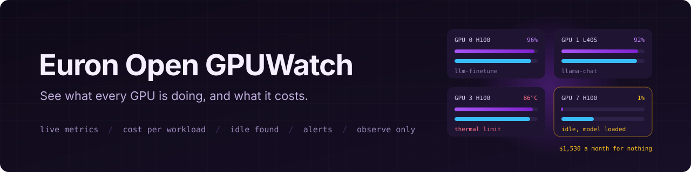
</p>

<p align="center">
  
  <a href="LICENSE"></a>
  
  
  
  
  
  
  
</p>

<p align="center">
  <a href="https://github.com/euron-sde-team/euron-open-gpuwatch/stargazers"></a>
  <a href="https://github.com/euron-sde-team/euron-open-gpuwatch/fork"></a>
  <a href="https://github.com/euron-sde-team/euron-open-gpuwatch/watchers"></a>
  <br>
  <a href="https://github.com/euron-sde-team/euron-open-gpuwatch/issues"></a>
  <a href="https://github.com/euron-sde-team/euron-open-gpuwatch/pulls"></a>
  <a href="https://github.com/euron-sde-team/euron-open-gpuwatch/commits/main"></a>
  
  <br>
  <a href="#built-by-the-team-behind-euron"></a>
</p>

<p align="center">
  <b><a href="#-quickstart">Quickstart</a></b> ·
  <b><a href="#️-architecture">Architecture</a></b> ·
  <b><a href="docs/guides/agent.md">Install the agent</a></b> ·
  <b><a href="docs/api/openapi.yaml">API reference</a></b> ·
  <b><a href="#️-deploy-to-aws">Deploy</a></b> ·
  <b><a href="docs/architecture/security.md">Security</a></b> ·
  <b><a href="#-documentation">Docs</a></b>
</p>

**Euron Open GPUWatch** is an open-source, MIT-licensed, self-hosted GPU monitoring and cost
platform, part of the open-source initiative of **ENGAGESPHERE TECHNOLOGY PRIVATE LIMITED**.
A small agent on each GPU machine reports utilization, memory, temperature, power, clocks,
throttling, errors and the processes on every NVIDIA GPU. GPUWatch turns that into live
views, history, the cost of every GPU hour at your own rates, and plain findings about the
money that bought nothing: a model loaded and idle all weekend, an 80 GB card whose job never
used 40, a GPU slowed by its thermal limit.

- **Live and history.** Every GPU on one screen, updated over a live stream; per-GPU charts
  from seconds to months, with readings the driver did not report shown as "Not available",
  never as zero.
- **Cost you can explain.** Every second of every GPU is priced from your hourly rates and
  split between the processes on it, so totals by workload, team, host, GPU or model add up
  to the cent. Idle time is its own line, split into "nothing running" and "held idle by a
  workload".
- **Findings with evidence.** Idle GPUs, underused and oversized cards, throttling, memory
  pressure, hardware errors and inference servers that queue or sit idle, each with the
  numbers behind it, what it costs a month and what to do.
- **Alerts that fire once.** Rules on any metric for any scope, email and signed webhooks,
  one notification when an alert fires and one when it resolves.
- **Observe only.** The agent opens no port, takes no commands and never starts or stops a
  process. GPUWatch tells you; you decide.

<p align="center">
  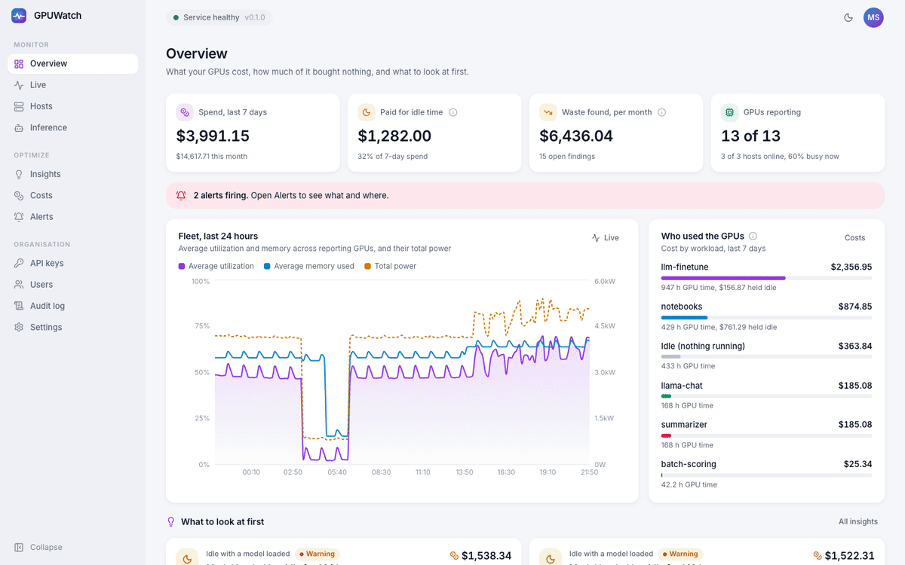
</p>

> [!NOTE]
> Everything in the tour ran for real: Docker Compose on a laptop, with S3, KMS and SES
> emulated locally and provisioned by the same Terraform modules that build production.
> **The GPUs are simulated.** Three agents run the real agent code with its simulated
> collector (8 H100s training, four inference GPUs behind vLLM and TGI, an RTX 4090
> workstation), backfill 30 days of history and then report live. The alerts in the tour
> fired on that live data. `make up && make demo` reproduces it. The NVML and DCGM
> collectors are tested against fakes; see the
> [compatibility matrix](docs/guides/agent.md#compatibility-matrix) for what has been
> verified on real hardware.

<h3 align="center">Built by the team behind Euron</h3>

<p align="center">Euron Open GPUWatch comes from the people who build these platforms. If you like how this repository is built, come and see what we build with it.</p>

<p align="center">
  <a href="https://euron.one"><picture><source media="(prefers-color-scheme: dark)" srcset="docs/assets/brand/euron-dark.svg"></picture></a>
  <a href="https://euronsystems.com"><picture><source media="(prefers-color-scheme: dark)" srcset="docs/assets/brand/euron-systems-dark.svg"></picture></a>
  <a href="https://alphaeuron.com"><picture><source media="(prefers-color-scheme: dark)" srcset="docs/assets/brand/alpha-euron-dark.svg"></picture></a>
</p>

<p align="center">
  <a href="https://www.instagram.com/euron_official"></a>
  <a href="https://www.linkedin.com/company/euronone/posts/"></a>
  <a href="https://x.com/euron712"></a>
  <a href="https://www.youtube.com/@Euron-official"></a>
  <a href="https://whatsapp.com/channel/0029VaeeJwq9RZAfPW9P2l07"></a>
</p>

---

## 📚 Table of contents

- [Why GPUWatch](#-why-gpuwatch)
- [At a glance](#-at-a-glance)
- [Screenshots](#️-screenshots)
- [Features](#-features)
- [Architecture](#️-architecture)
- [Performance](#-performance)
- [Tech stack](#-tech-stack)
- [Prerequisites](#-prerequisites)
- [Quickstart](#-quickstart)
- [Monitor real GPUs](#-monitor-real-gpus)
- [Explore the repository](#-explore-the-repository)
- [API](#-api)
- [Configuration](#️-configuration)
- [Deploy to AWS](#️-deploy-to-aws)
- [Security model](#-security-model)
- [Testing](#-testing)
- [Documentation](#-documentation)
- [Roadmap](#️-roadmap)
- [FAQ](#-faq)
- [Contributing, security and license](#-contributing-security-and-license)

## 💡 Why GPUWatch

GPUs are the most expensive line in most AI budgets, and the least explained. `nvidia-smi`
shows one machine at one moment. A Prometheus and Grafana stack shows curves, but not who
used the GPU, what an hour of it cost, or that the notebook on GPU 7 has held 30 GB of VRAM
at 1% utilization since Friday. Cloud bills show the total, never the waste.

GPUWatch answers the questions a team actually asks:

- **What is running right now, and is anything wrong?** Live tiles for every GPU, hot and
  throttled cards marked, alerts when an agent goes quiet, a GPU disappears or memory fills.
- **What did it cost, and who used it?** Every GPU second priced and attributed to the
  process (and through your rules, the workload and team) that used it.
- **What should we change?** Findings ranked by what they cost a month, each with its
  evidence, so the fix is a decision rather than an investigation.

It stays light: one agent per machine, a single Postgres, Redis only if you want it, and
nothing on the GPU machines but an outbound HTTPS connection.

## 📊 At a glance

| | |
| --- | --- |
| **Collectors** | NVML (`nvidia-ml-py`), an existing DCGM exporter, or a deterministic simulator; vLLM and TGI `/metrics` |
| **Metrics** | Utilization, memory bandwidth, memory used, temperature, power and limit, SM and memory clocks, throttle reasons, PCIe, ECC, XID events, processes |
| **History** | Raw samples (7 days), 1 minute rollups (30 days), 1 hour rollups (400 days), all configurable |
| **Cost** | Hourly rates per GPU, host or model; integer nano-dollars; per process, workload, team, host, GPU and model; CSV reports |
| **Findings** | 9 kinds: idle with a model loaded, idle and empty, underused, oversized memory, throttled, memory pressure, hardware errors, inference queueing, inference overprovisioned |
| **Alerts** | Rules on any metric, scoped by host, GPU, model or label; email (SMTP or SES) and HMAC-signed webhooks; outbox with retries |
| **Integrations** | Read-only API keys, Prometheus `/metrics` exposition of the whole fleet |
| **Infrastructure** | 10 Terraform modules, 3 environments; the full AWS stack applied end to end against Floci |
| **Tests** | 111 API unit, 34 agent, 36 dashboard, 87 integration (under 8 backend combinations), 19 browser end-to-end, a browser QA sweep |
| **License** | MIT |

## 🖼️ Screenshots

<table>
  <tr>
    <td width="50%">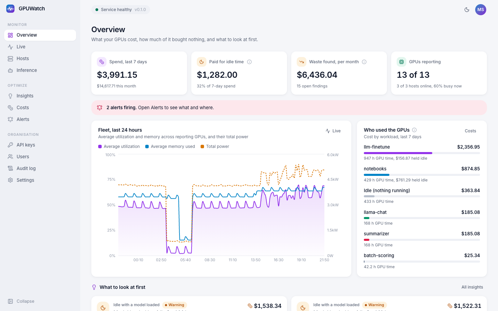<br><sub><b>Overview.</b> Spend, what idle time cost, waste found and fleet health, who used the GPUs, and what to look at first.</sub></td>
    <td width="50%">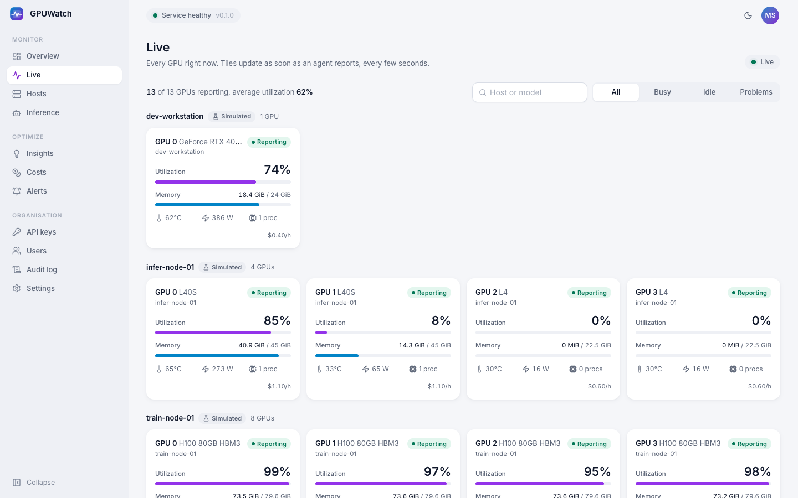<br><sub><b>Live.</b> Every GPU right now, grouped by host, updated over a live stream; filters for busy, idle and problems.</sub></td>
  </tr>
  <tr>
    <td>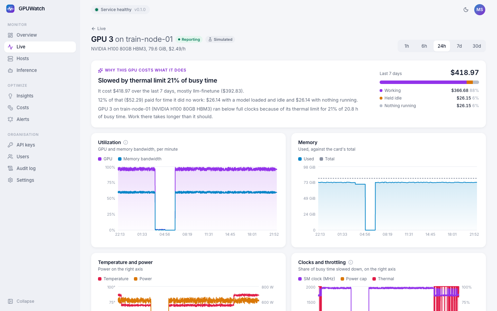<br><sub><b>GPU detail.</b> Why this GPU costs what it does, then utilization, memory, temperature, power, clocks and throttling over time.</sub></td>
    <td>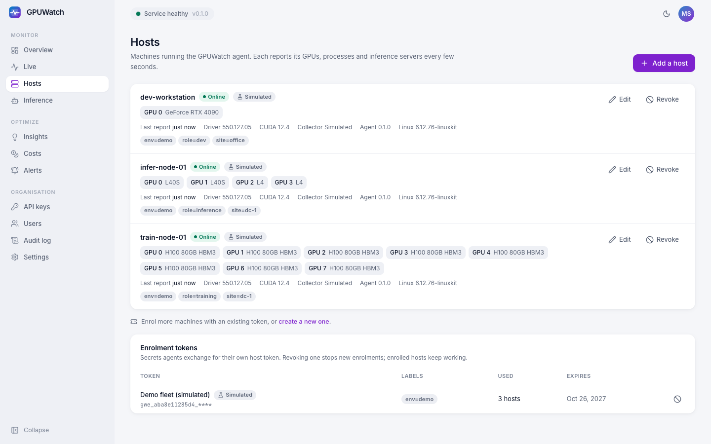<br><sub><b>Hosts.</b> Every machine and agent, its GPUs and labels; add a host with a one-time enrolment token.</sub></td>
  </tr>
  <tr>
    <td>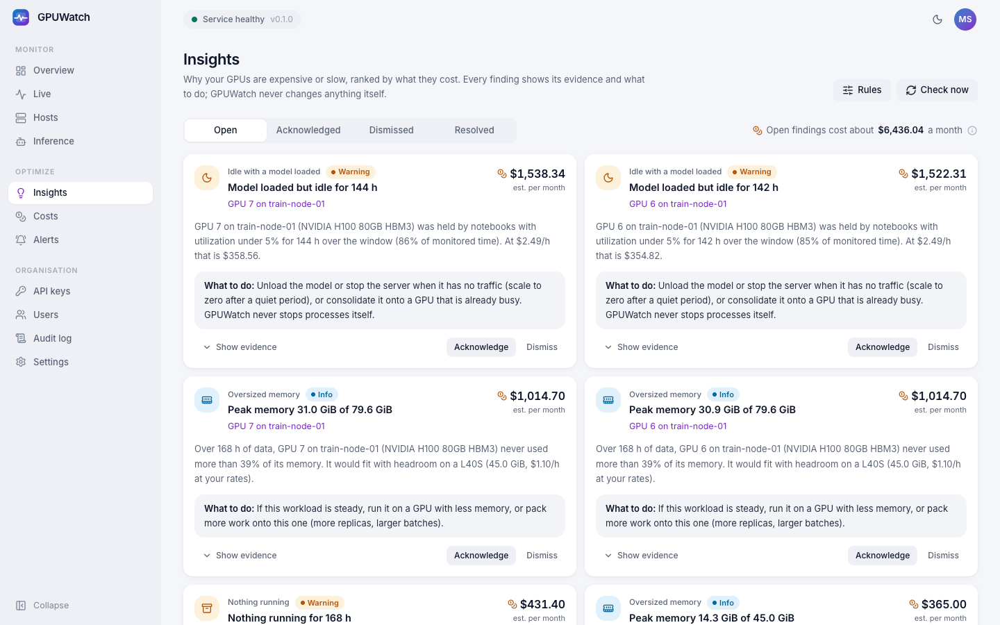<br><sub><b>Insights.</b> Findings ranked by what they cost a month, each with what to do.</sub></td>
    <td>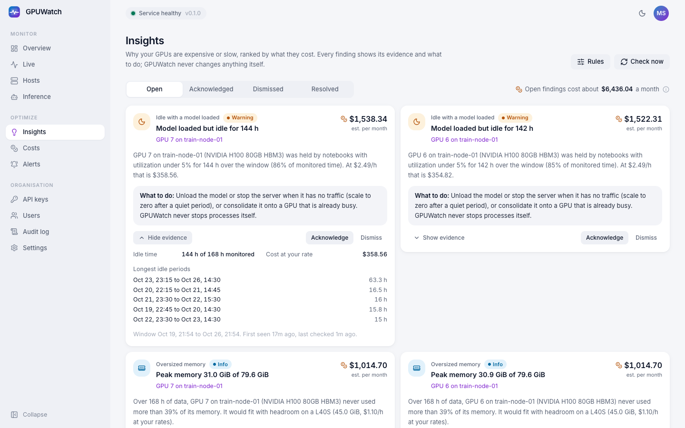<br><sub><b>Evidence.</b> The numbers behind a finding: idle hours, the longest idle periods, the cost at your rate.</sub></td>
  </tr>
  <tr>
    <td>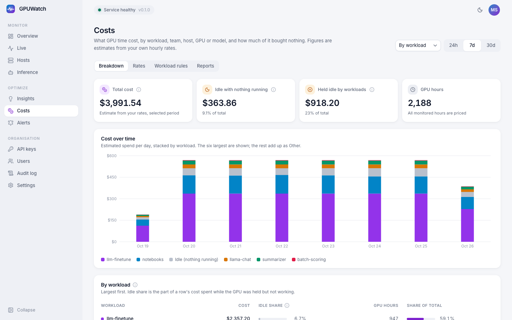<br><sub><b>Costs.</b> Spend by workload, team, host, GPU or model, with idle split out, over 24 hours to 30 days.</sub></td>
    <td>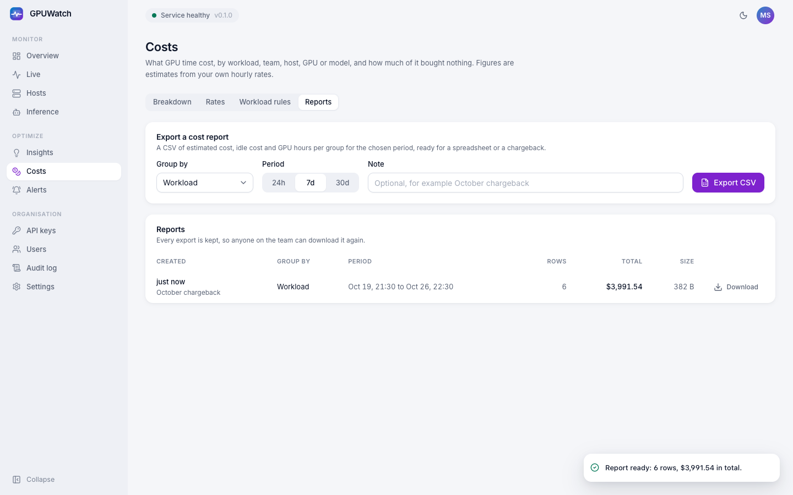<br><sub><b>Reports.</b> CSV exports for a spreadsheet or a chargeback, kept for the whole team.</sub></td>
  </tr>
  <tr>
    <td>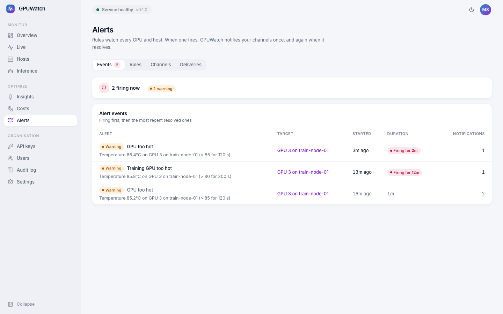<br><sub><b>Alerts.</b> What is firing and what resolved, with the reading that triggered it and the notifications sent.</sub></td>
    <td>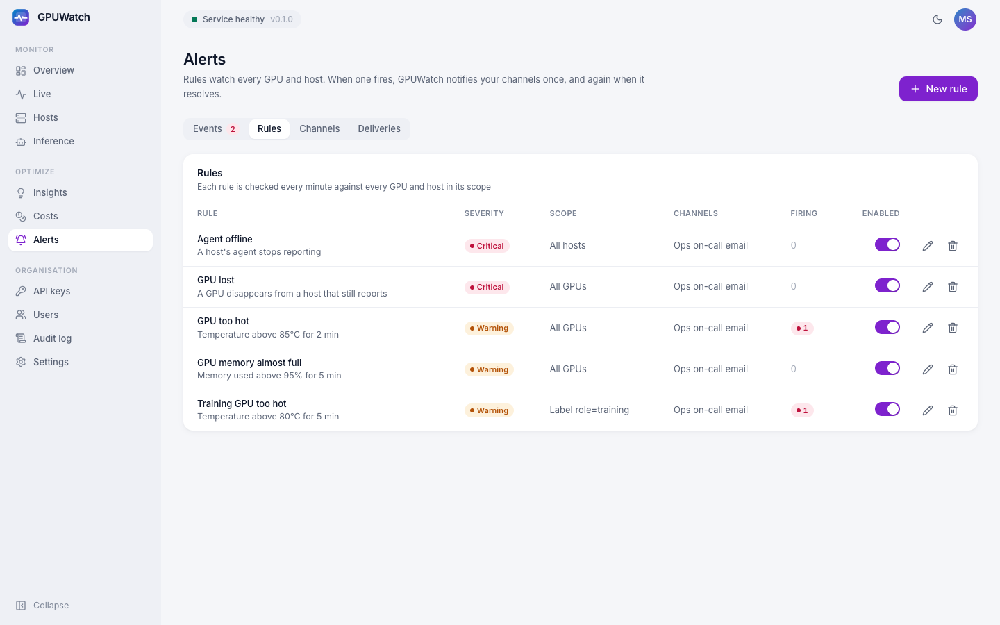<br><sub><b>Alert rules.</b> Built-in rules for offline agents, lost GPUs, heat and memory, plus your own.</sub></td>
  </tr>
  <tr>
    <td>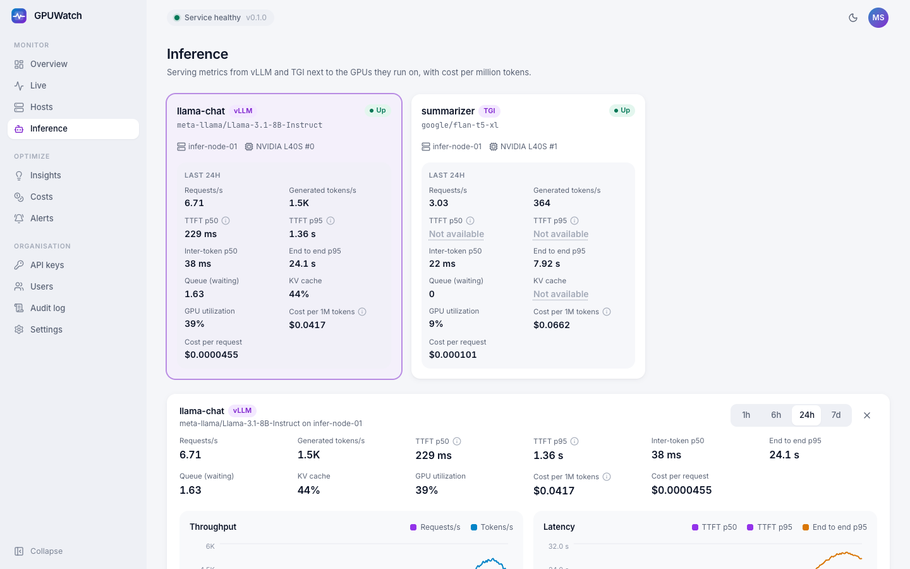<br><sub><b>Inference.</b> vLLM and TGI throughput, latency percentiles, queue and KV cache next to the GPU they run on, with cost per million tokens.</sub></td>
    <td>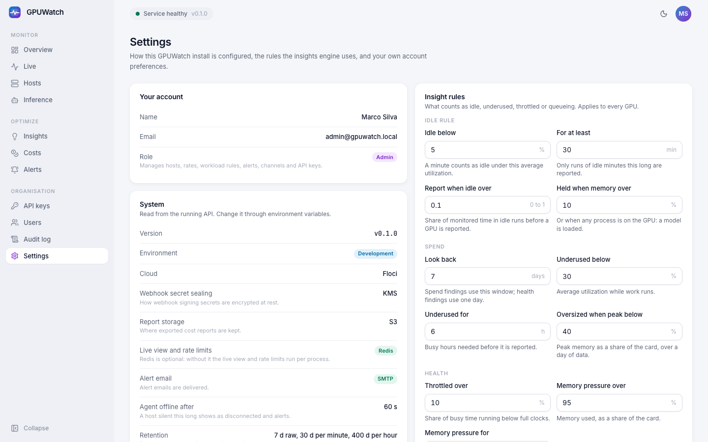<br><sub><b>Settings.</b> How the install is configured, and the thresholds the insights engine uses, editable.</sub></td>
  </tr>
  <tr>
    <td>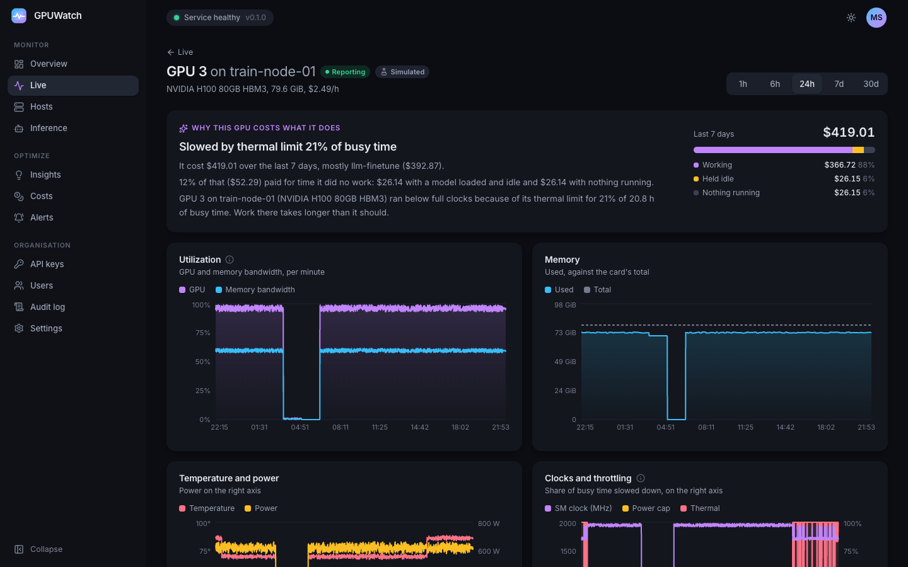<br><sub><b>Dark mode.</b> The same GPU detail in the dark theme.</sub></td>
    <td align="center">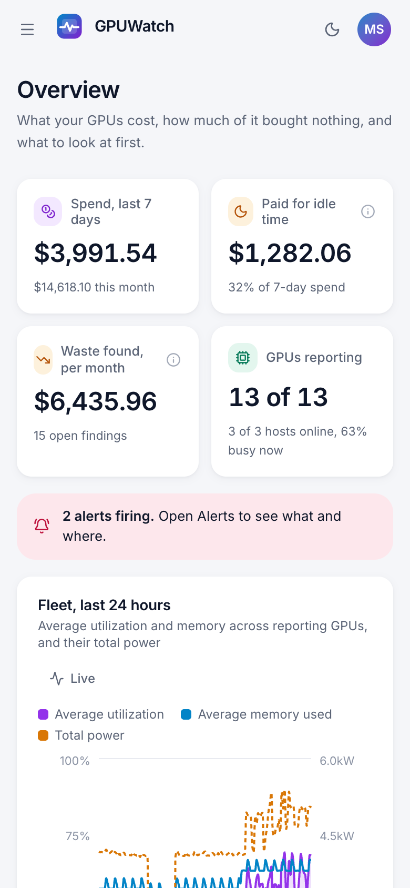<br><sub><b>Phone.</b> Responsive down to phone width.</sub></td>
  </tr>
  <tr>
    <td>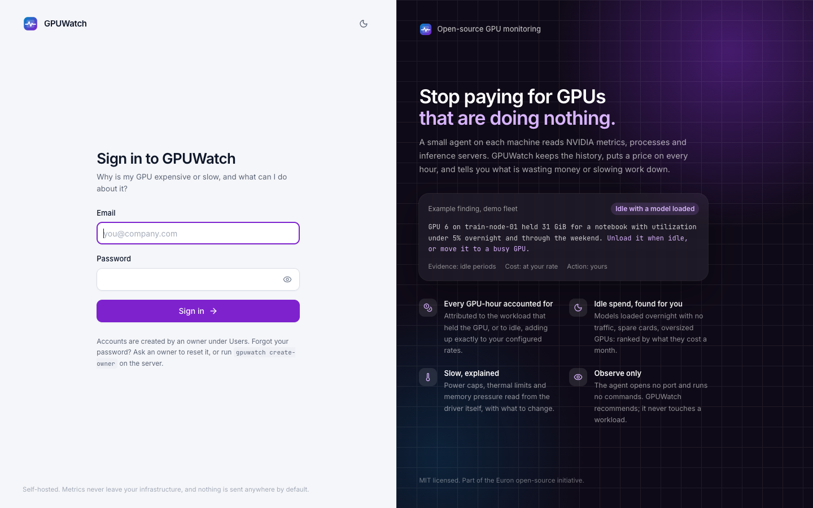<br><sub><b>Sign in.</b> Owner, admin and viewer roles.</sub></td>
    <td></td>
  </tr>
</table>

## ✨ Features

<table>
<tr>
<td valign="top" width="50%">

#### 📡 Collect
- **NVML** through `nvidia-ml-py`, or scrape an **existing DCGM exporter**.
- **Processes** with names, users and container ids, and their memory and SM share.
- **vLLM and TGI** request, token, latency, queue and KV cache metrics, with counter resets
  handled.
- **Reliable delivery**: a disk spool replays batches after an outage; idempotent batch ids
  mean nothing is counted twice.

</td>
<td valign="top" width="50%">

#### 💸 Price
- **Rates** per GPU, per host or per model; the most specific wins.
- **Attribution** of every interval to processes by SM share, then memory, then equally.
- **Workload rules** by process name, user, container or label, applied to history too.
- **Exact totals**: integer nano-dollars and largest-remainder splits, so every grouping
  adds up.

</td>
</tr>
<tr>
<td valign="top">

#### 🔎 Find
- **Nine finding kinds**, each with evidence, a monthly cost and what to do.
- **Lifecycle**: acknowledge, dismiss, or let it resolve itself when the condition clears.
- **Tunable** idle rule and thresholds from the dashboard.
- **Never acts**: findings suggest; nothing is stopped or changed.

</td>
<td valign="top">

#### 🔔 Operate
- **Alerts** with durations, scopes and severities; one firing per rule and target.
- **Email** (SMTP or SES) and **webhooks** signed with HMAC-SHA256, retried with backoff.
- **Roles**, read-only API keys, an append-only audit log.
- **Prometheus** `/metrics` for the fleet and the service, JSON logs with request ids.

</td>
</tr>
</table>

## 🏗️ Architecture

<p align="center">
  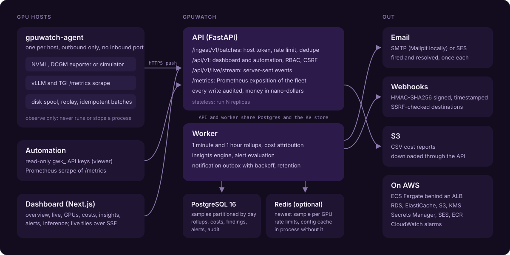
</p>

The agent pushes one batch every 5 seconds over HTTPS. The API checks the host token,
writes raw samples into day partitions in Postgres and the newest sample per GPU into the
KV store, which feeds the live view and its server-sent event stream. A worker turns raw
samples into 1 minute and 1 hour rollups, attributes cost per hour, evaluates findings and
alert rules, delivers notifications from an outbox and drops expired partitions. Dashboard
reads come from the rollups, never from the raw table, so a 30-day chart is as fast as a
1-hour one. Details: [HLD](docs/architecture/HLD.md),
[ingest and rollups](docs/architecture/ingest-and-rollups.md),
[cost attribution](docs/architecture/cost-attribution.md),
[insights](docs/architecture/insights.md), [alerts](docs/architecture/alerts.md),
[the agent](docs/architecture/agent.md).

## ⚡ Performance

Measured with `make bench` against the production images in Docker Compose on a laptop
(Apple silicon, Docker Desktop), over HTTP, with the three demo agents reporting at the
same time. Batches carry 8 GPUs and 3 processes each.

| | p50 | p95 |
| --- | ---: | ---: |
| Ingest, one batch | 20.3 ms | 59.9 ms |
| Live snapshot of 13 GPUs | 16.1 ms | 46.8 ms |
| Overview (spend, idle cost, findings, fleet) | 234.9 ms | 337.0 ms |
| GPU history, 24 hours (1 minute rollups) | 35.6 ms | 145.6 ms |
| GPU history, 7 days (1 hour rollups) | 12.8 ms | 27.6 ms |
| Costs by workload, 7 days | 45.6 ms | 163.8 ms |

Ingest throughput with 7 agents posting at once: 105 batches a second, 840 GPU samples and
3,359 rows a second. At one sample per GPU every 5 seconds that is room for about 4,000
GPUs on one API container with one worker process; the API is stateless, so more replicas
add more.

## 🧰 Tech stack

| Layer | Technology |
| --- | --- |
| Agent | Python 3.12, `nvidia-ml-py`, httpx, a Prometheus text parser; no root needed |
| API and worker | FastAPI, SQLAlchemy 2 (async, asyncpg), Alembic, Pydantic v2, redis-py, boto3 |
| Dashboard | Next.js 15 (App Router), React 19, TypeScript, Tailwind CSS 4, shadcn components, TanStack Query, Recharts |
| Data | PostgreSQL 16 (range partitions by day), Redis 7 (optional; Valkey on AWS), S3 |
| AWS | ECS Fargate, ALB, WAF, RDS, ElastiCache, S3, KMS, SES, Secrets Manager, ECR, CloudWatch |
| Local | Docker Compose, Floci (AWS emulator), Mailpit, a mock vLLM server |
| Quality | pytest, Vitest, Playwright, Puppeteer, ruff, mypy `--strict`, ESLint, tflint, checkov |

## 📋 Prerequisites

- Docker with Compose v2
- `make`, `bash`, `openssl`
- For development outside containers: Python 3.12 with [uv](https://docs.astral.sh/uv/),
  Node 22 and pnpm 9

## 🚀 Quickstart

```bash
git clone https://github.com/euron-sde-team/euron-open-gpuwatch.git
cd euron-open-gpuwatch
make up      # Postgres, Redis, Mailpit, Floci (provisioned by Terraform), api, worker, dashboard
make demo    # rates, rules, alerts, a key, and three simulated agents; prints the logins
```

Open the dashboard at http://localhost:4410 and sign in with a printed login. The agents
backfill 30 days of history (about 4 minutes on a laptop), then report live. Alert email
lands in Mailpit at http://localhost:4425.

Read the same data from a script with the printed read-only key:

```bash
curl -H "Authorization: Bearer gwk_..." http://localhost:4430/api/v1/overview
curl -H "Authorization: Bearer gwk_..." "http://localhost:4430/api/v1/costs?group_by=team"
```

[The quickstart guide](docs/guides/quickstart-local.md) walks through every screen.
`make down` removes everything.

## 🖥️ Monitor real GPUs

In the dashboard open **Hosts**, **Add a host**, and copy the command it prints. On a
machine with the NVIDIA driver and the Container Toolkit:

```bash
docker run -d --name gpuwatch-agent --restart unless-stopped \
  --gpus all --pid=host \
  -e GPUWATCH_URL=https://gpuwatch.example.com \
  -e GPUWATCH_ENROLMENT_TOKEN=gwe_... \
  -v gpuwatch-agent:/var/lib/gpuwatch-agent \
  gpuwatch-agent run
```

Or `pip install` the agent and run it as a systemd service; or point it at a DCGM exporter
you already run. Inference servers are added with one variable. Everything is in the
[agent guide](docs/guides/agent.md).

## 🧭 Explore the repository

```text
euron-open-gpuwatch/
├── apps/
│   ├── agent/               gpuwatch-agent: NVML, DCGM and simulated collectors, inference
│   │                        scraping, spool and replay, the demo scenarios, a mock vLLM
│   ├── api/                 Python package: API, worker, CLI, benchmark
│   │   └── src/gpuwatch/
│   │       ├── ingest/          host-token auth, validation, idempotent batches
│   │       ├── telemetry/       partitions, live view and stream, rollups, retention, series
│   │       ├── costs/           rates, attribution, workload rules, summaries, reports
│   │       ├── insights/        the findings engine, its settings and lifecycle
│   │       ├── alerts/          rules, evaluation, the outbox, email and webhooks
│   │       ├── inference/       endpoint metrics, histograms, hourly rollups
│   │       ├── fleet/ overview/ observability/ auth/ users/ keys/ audit/ system/
│   │       ├── core/            config, db, optional KV, cache, errors, security, storage, mail
│   │       └── worker.py        the scheduled jobs
│   └── web/                 Next.js dashboard (features/<domain>, components, lib)
├── examples/                an idle report script and a webhook receiver
├── infra/
│   ├── terraform/           modules + envs (local-floci, aws-dev, aws-prod)
│   └── docker/              api, web and agent images
├── deploy/compose/          the local stack (Floci or real AWS overlay), demo agents
├── e2e/                     Playwright browser tests
├── scripts/                 QA sweep and screenshots, test matrix, sanitization check
└── docs/                    architecture, ADRs, guides, OpenAPI
```

## 🔌 API

Everything the dashboard shows comes from the REST API under `/api/v1`, described in the
[OpenAPI reference](docs/api/openapi.yaml) (interactive at `/docs`). Automation uses
read-only `gwk_` keys; the dashboard uses a session cookie with a CSRF header. Errors share
one envelope `{"error": {"code", "message", "details"}}`.

| Area | Endpoints |
| --- | --- |
| Fleet | `/hosts`, `/gpus`, `/gpus/{id}/metrics`, `/gpus/{id}/processes`, `/live`, `/live/stream` |
| Cost | `/costs`, `/costs/series`, `/rates`, `/workload-rules`, `/reports`, `/reports/{id}/download` |
| Findings | `/insights`, `/insights/{id}/actions`, `/insights/evaluate`, `/settings/insights`, `/gpus/{id}/explain` |
| Alerts | `/alerts/events`, `/alerts/rules`, `/alerts/channels`, `/alerts/notifications` |
| Inference | `/inference/endpoints`, `/inference/endpoints/{id}/series` |
| Agents | `POST /ingest/v1/enroll`, `POST /ingest/v1/batches` (enrolment and host tokens only) |
| Prometheus | `/metrics` (optionally behind `METRICS_TOKEN`) |

Webhooks to a channel with a secret carry
`X-GPUWatch-Signature: sha256=HMAC(secret, "<timestamp>.<body>")`; a receiver that
verifies it is in [examples/](examples/).

## ⚙️ Configuration

All settings are environment variables, validated at boot; production refuses unsafe ones.
The most important:

| Variable | Default | |
| --- | --- | --- |
| `REDIS_URL` | empty | Empty runs without Redis (per-process live view, limits and cache) |
| `MAIL_MODE` | `log` | `smtp` or `ses` to deliver alert email |
| `RAW_RETENTION_DAYS` | `7` | Raw samples; rollups keep 30 and 400 days by default |
| `HOST_OFFLINE_AFTER_S` | `60` | A silent agent shows as disconnected and alerts |
| `INGEST_RPM_PER_HOST` | `240` | Batches per minute one host may send |
| `WEBHOOK_ALLOW_PRIVATE` | `true` | Webhooks to private networks (an internal chat relay); metadata and link-local addresses are always refused |
| `METRICS_TOKEN` | empty | Require a bearer token on `/metrics` |

The insight thresholds (what counts as idle, underused or throttled) are edited in the
dashboard. The full list is in the [configuration reference](docs/guides/configuration.md).

## ☁️ Deploy to AWS

```bash
cp infra/terraform/envs/aws-dev/terraform.tfvars.example infra/terraform/envs/aws-dev/terraform.tfvars
make aws-deploy ENV=aws-dev TAG=0.1.0      # registries, arm64 images, apply, migrations, wait
GPUWATCH_OWNER_PASSWORD=... make aws-admin ENV=aws-dev EMAIL=you@example.com   # first owner
```

This creates a VPC, RDS PostgreSQL, ElastiCache, an encrypted reports bucket, a KMS key, an
SES identity, Secrets Manager entries, ECR, ECS Fargate services behind an ALB with WAF, and
CloudWatch alarms. The maintainers develop against the local emulator; the AWS
environments pass `terraform validate`, tflint and checkov, and the full `aws-dev` stack is
applied and destroyed against Floci (`make tf-aws-on-floci`). Step by step:
[deploy guide](docs/guides/deploy-aws.md).

## 🔐 Security model

| Area | How |
| --- | --- |
| Agents | Outbound HTTPS only, no listening port, no remote commands; enrolment tokens with expiry and machine limits exchanged for a per-host token; revocation takes effect on the next batch |
| Tokens and keys | `gwe_`, `gwh_` and `gwk_` tokens stored only as peppered HMACs, shown once; API keys are read-only and rate limited |
| Webhooks | Destinations resolved and checked before every delivery (metadata and link-local always refused, private networks optional), an optional signing secret sealed with KMS, every request timestamped and, with a secret, signed |
| Dashboard | argon2id, atomic lockout and per-IP throttling, owner, admin and viewer roles enforced in the API, CSRF header, CSP and HSTS, sessions ended on sign-out, password or role change |
| Data | No GPU process is ever started or stopped; the agent reads process names, not command lines or environments; every configuration change is in an append-only audit log |
| Infrastructure | Private subnets, TLS, KMS encryption, least-privilege task roles, WAF, `/metrics` restricted, checkov clean |

Report vulnerabilities privately: see [SECURITY.md](SECURITY.md). Details:
[security](docs/architecture/security.md), [threat model](docs/architecture/threat-model.md).

## 🧪 Testing

| Suite | What it proves | Run |
| --- | --- | --- |
| API unit (111) | The agent wire contract (impossible readings become "Not available"), the insights engine, cost attribution, the GPU-hour cap and exact splits, CSV formula quoting, histograms, alert evaluation helpers, URL safety and signatures, config guards, security primitives, KV and cache | `make test` |
| Agent (34) | NVML against a fake library, DCGM and inference parsing with counter resets, the spool and replay, re-enrolment and backing off when revoked, a dropped connection retried once, readings that are not numbers sent as null, the simulator | `make test` |
| Dashboard (36) | Formatting (money, units, "Not available"), charts, chips, roles and components | `make test` |
| Integration (87) | The real API and worker against Postgres, Redis, Floci, Mailpit and a webhook receiver: every acceptance criterion, ingest idempotency and limits, rollups and races, cost totals, alert lifecycle and delivery, revocation that sticks, RBAC and masked webhook URLs, hostile input, an open live stream holding no connection, Redis down | `make test-integration` |
| Option matrix (8 runs) | The integration suite under every cache, key, storage and mail backend (Redis or none, local or KMS, disk or S3, SMTP or SES) | `make test-matrix` |
| Browser (19) | Sign in and out with safe redirects, live tiles, a GPU's detail with no missing metric shown as zero, adding a host until its agent reports, insights acknowledged, costs and a CSV export, rates, insight rules, a test email and an alert delivered, inference metrics, read-only keys, users and roles, password change, what a viewer cannot see | `make e2e` |
| Browser QA | Every page in light and dark at desktop and phone width: no console errors, failed requests, broken images or overflow | `make qa` |
| Infrastructure | `terraform validate` (3 environments), tflint, checkov, sanitization (secrets, account ids, em and en dashes) | `make tf-validate tf-lint tf-security sanitize` |
| AWS on Floci | The full production environment plans, applies, converges and destroys against an AWS API | `make tf-aws-on-floci` |

Line coverage of `apps/api/src` from the unit and integration suites together: 90%.
[Testing guide](docs/guides/testing.md)

## 📖 Documentation

| Architecture | Guides |
| --- | --- |
| [High-level design](docs/architecture/HLD.md) | [Quickstart (local)](docs/guides/quickstart-local.md) |
| [Low-level design](docs/architecture/LLD.md) | [Install the agent](docs/guides/agent.md) |
| [Ingest and rollups](docs/architecture/ingest-and-rollups.md) | [Configuration reference](docs/guides/configuration.md) |
| [Cost attribution](docs/architecture/cost-attribution.md) | [Deploy to AWS](docs/guides/deploy-aws.md) |
| [Insights](docs/architecture/insights.md) | [Local against real AWS](docs/guides/local-with-aws.md) |
| [Alerts](docs/architecture/alerts.md) | [Operations runbook](docs/guides/operations.md) |
| [The agent](docs/architecture/agent.md) | [Testing](docs/guides/testing.md) |
| [Data model](docs/architecture/data-model.md) | [Troubleshooting](docs/guides/troubleshooting.md) |
| [Security](docs/architecture/security.md) and [threat model](docs/architecture/threat-model.md) | [Code walkthrough](docs/guides/walkthrough.md) |
| [Decision records](docs/architecture/adr/) | [API reference (OpenAPI)](docs/api/openapi.yaml) |

## 🗺️ Roadmap

- Verification on more real hardware (A100, H100, L4, consumer cards) and published results
- MIG instances as first-class devices, with their own cost and findings
- AMD GPUs through ROCm SMI
- Slurm and Kubernetes job attribution (pod and job ids as workloads)
- Budgets per team with alerts on forecast spend
- Slack and PagerDuty channels next to email and webhooks
- A Helm chart and a DaemonSet for the agent

Have an idea? [Open a feature request](https://github.com/euron-sde-team/euron-open-gpuwatch/issues/new/choose).

## ❓ FAQ

<details>
<summary><b>Do I need a GPU to try it?</b></summary>

No. `make demo` runs three agents with the simulated collector, which models a training
node, an inference node and a workstation, including idle weekends, a hot GPU and an XID
error. Everything else (ingest, rollups, cost, findings, alerts) is the real code.
</details>

<details>
<summary><b>Has it been run on real NVIDIA GPUs?</b></summary>

The NVML collector uses the official `nvidia-ml-py` bindings and is tested against a fake
NVML library that follows the documented API, including calls that are not supported on
some cards. The [compatibility matrix](docs/guides/agent.md#compatibility-matrix) lists what
has been verified on real hardware so far; reports from your cards are very welcome.
</details>

<details>
<summary><b>Can GPUWatch stop an idle job for me?</b></summary>

No, by design. The agent cannot run anything, and findings say what to do rather than
doing it. An idle GPU might be holding the only copy of a model someone is about to use.
</details>

<details>
<summary><b>How accurate is the cost?</b></summary>

It is exactly your rates times the GPU time GPUWatch saw, split between processes by their
share of the GPU. It is not your cloud bill: discounts, storage and network are not in it.
Every total adds up to the nano-dollar across any grouping.
</details>

<details>
<summary><b>What does it cost to run?</b></summary>

One Postgres, the API and a worker. Redis is optional. A day of raw samples for 13 GPUs and
their processes is a few hundred thousand rows; rollups keep long history small, and
retention drops whole day partitions instead of deleting rows.
</details>

<details>
<summary><b>Does it work alongside Prometheus and Grafana?</b></summary>

Yes. `/metrics` exposes every GPU's latest reading in Prometheus format, and the agent can
read from a DCGM exporter you already run, so GPUWatch adds cost and findings to a stack
you keep.
</details>

<details>
<summary><b>Do I need an AWS account to try it?</b></summary>

No. `make up` runs everything on Docker, with S3, KMS and SES on a local emulator
provisioned by the same Terraform modules as production, and Mailpit to read alert email.
</details>

## 🤝 Contributing, security and license

Contributions are welcome: read [CONTRIBUTING.md](CONTRIBUTING.md) and the
[code of conduct](CODE_OF_CONDUCT.md). Report security issues privately as described in
[SECURITY.md](SECURITY.md).

Released under the [MIT License](LICENSE). Copyright (c) 2026 ENGAGESPHERE TECHNOLOGY
PRIVATE LIMITED and the Euron Open GPUWatch contributors.

<p align="center">
  If GPUWatch shows you a GPU you were paying for and not using, <b><a href="https://github.com/euron-sde-team/euron-open-gpuwatch/stargazers">⭐ star the repository</a></b>.
</p>
