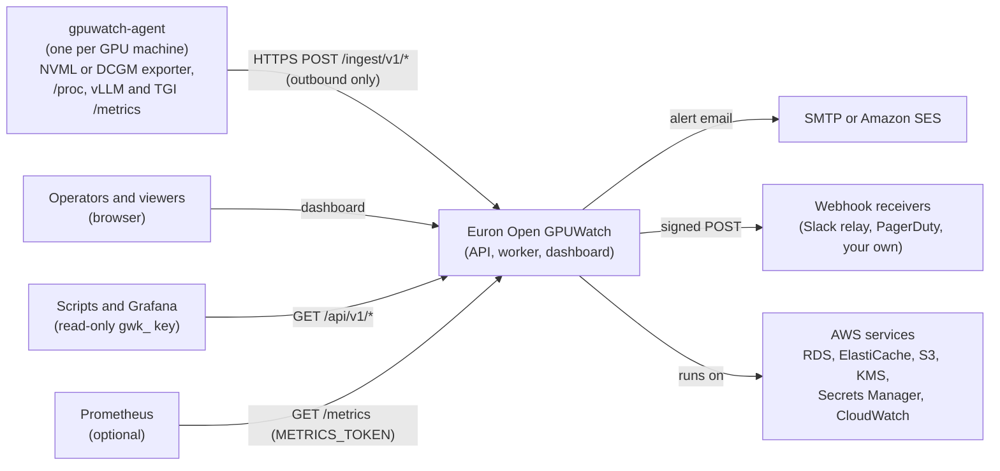
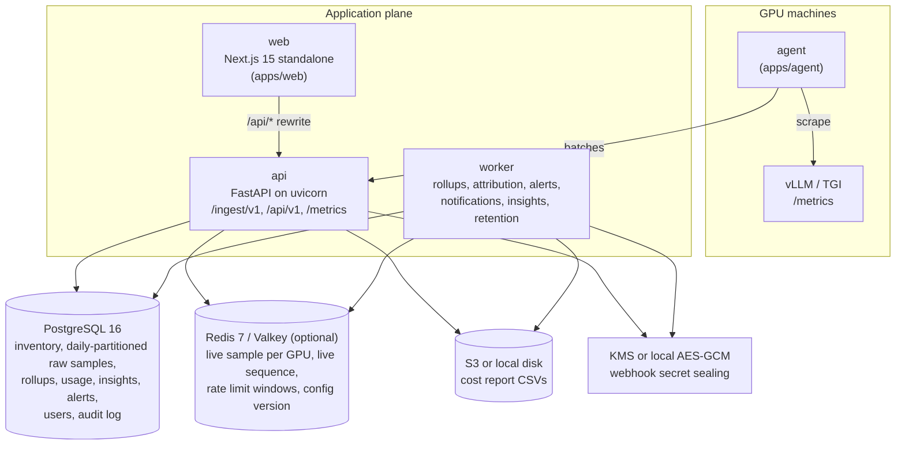
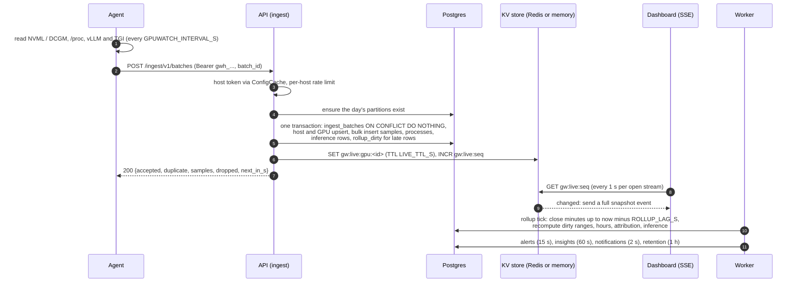

# High-Level Design

This document describes what Euron Open GPUWatch is made of, how the pieces talk to each
other, and how the system behaves under load and failure. Module-level detail is in the
[Low-Level Design](LLD.md), the tables in the [Data Model](data-model.md), and the
subsystems that carry most of the correctness argument in their own documents:
[Ingest and rollups](ingest-and-rollups.md), [Cost attribution](cost-attribution.md),
[Insights](insights.md), [Alerts](alerts.md) and [the agent](agent.md). The reasoning
behind each major choice is in the [ADRs](adr/README.md).

- [Goals and non-goals](#goals-and-non-goals)
- [System context](#system-context)
- [Containers](#containers)
- [Component responsibilities](#component-responsibilities)
- [Data flow](#data-flow)
- [Worker jobs](#worker-jobs)
- [Caching layers](#caching-layers)
- [Scalability](#scalability)
- [Availability and failure modes](#availability-and-failure-modes)
- [Security summary](#security-summary)
- [Observability](#observability)
- [Key design decisions](#key-design-decisions)

## Goals and non-goals

GPUWatch answers "why is my GPU expensive or slow, and what can I do about it?" A small
agent on each GPU machine reads NVIDIA metrics (NVML, or an existing DCGM exporter), the
processes on each GPU and the metrics of local inference servers (vLLM, TGI), and pushes
them to the API. The API stores the history, attributes every monitored GPU-second to a
workload or to idle, prices it with the rates you configure, turns the history into
findings with evidence, and alerts by email or webhook. The name is the contract: a watch
keeps watching and raises its hand, and it never touches what it watches.

**Goals**

| # | Goal | How it is met |
| - | ---- | ------------- |
| G1 | Every reachable GPU is recorded continuously | The agent sends one batch per interval (5 s by default); batches are idempotent and spooled to disk while the API is unreachable ([agent.md](agent.md)) |
| G2 | "Not available" is never shown as 0 | Every metric column is nullable from the agent's wire format to the database to the dashboard; rollups average only reported values ([ingest-and-rollups.md](ingest-and-rollups.md)) |
| G3 | Every GPU-hour is accounted for, exactly | Each sample's interval is split across processes; samples with no process are idle (or unattributed when the GPU is busy); per GPU-hour the cost is computed once and split by largest remainder ([cost-attribution.md](cost-attribution.md)) |
| G4 | Findings come with evidence | A pure rules engine over minute rollups: idle with a model loaded, idle and empty, underused, oversized VRAM, throttled, memory pressure, hardware errors, inference queueing and overprovisioning ([insights.md](insights.md)) |
| G5 | Someone hears about it before a GPU runs out of memory or goes dark | Stateless alert evaluation every 15 s, one event per (rule, target) enforced by a partial unique index, a notification outbox with retries ([alerts.md](alerts.md)) |
| G6 | Observe only | The agent opens no port and accepts no commands; no API route starts or stops a process (acceptance criterion 11, tested over the route table and the agent code) |
| G7 | Private by default | Nothing contacts a host outside the configured API, the machines' own endpoints and the channels an admin configures; no telemetry (acceptance criterion 12) |
| G8 | Runs on a laptop without a GPU or an AWS account | Simulated agents through the real ingest path, and a local AWS emulator (Floci) provisioned by the same Terraform as production |

**Non-goals (0.1.0)**

- **Acting on machines.** GPUWatch recommends; it never kills, starts or reconfigures
  anything. Opt-in remediation is on the roadmap in [PLAN.md](../PLAN.md).
- **Kubernetes-native attribution.** Pods and namespaces are roadmap items; today a
  workload is matched by process name, container id prefix, user or host label.
- **Other vendors.** NVIDIA only (NVML or DCGM exporter). The collector Protocol is where
  ROCm SMI would plug in.
- **Built-in prices.** GPUWatch ships no rates. Costs are estimates from rates you enter.
- **Multi-tenancy.** One install serves one organisation.

## System context

## Containers

The API image runs the HTTP API (`gpuwatch serve`), the background worker
(`gpuwatch worker`) and one-off commands (`migrate`, `create-owner`, `seed-demo`,
`openapi`). The web image runs the dashboard. The agent image runs on GPU machines; in the
local demo it also runs the mock vLLM server.

## Component responsibilities

| Component | Code | Owns | Never does |
| --------- | ---- | ---- | ---------- |
| Agent | [`apps/agent`](../../apps/agent) | Reading NVML or a DCGM exporter, enriching processes from `/proc`, scraping vLLM and TGI, the disk spool, enrolment | Open a port, run anything it receives, write to the GPU |
| Ingest | [`ingest/`](../../apps/api/src/gpuwatch/ingest) | Host token auth, per-host rate limit, the batch contract, idempotent storage, dirty ranges, live publish | Read anything back to the agent except `next_in_s` |
| Fleet | [`fleet/`](../../apps/api/src/gpuwatch/fleet) | Enrolment tokens, enrolment, hosts and GPUs, derived status (online, disconnected, lost) | Store status (it is derived from last-seen times) |
| Telemetry | [`telemetry/`](../../apps/api/src/gpuwatch/telemetry) | Raw sample partitions, minute and hour rollups, history queries, the live store and SSE stream, retention | Scan raw tables for ranges over 3 hours |
| Costs | [`costs/`](../../apps/api/src/gpuwatch/costs) | Rates, workload rules, attribution, exact cost summaries, CSV reports | Invent a price |
| Insights | [`insights/`](../../apps/api/src/gpuwatch/insights) | The pure rules engine, finding lifecycle, the "explain this GPU" summary, thresholds in settings | Claim a saving, change a machine |
| Alerts | [`alerts/`](../../apps/api/src/gpuwatch/alerts) | Rules, stateless evaluation, events, channels, the notification outbox, SSRF checks, HMAC signing | Keep alert state in memory |
| Inference | [`inference/`](../../apps/api/src/gpuwatch/inference) | Endpoints bound to GPUs, histogram merge and quantiles, hourly rollups, cost per million tokens | Guess a cost when a GPU has no rate |
| Platform | `auth/`, `users/`, `keys/`, `audit/`, `system/`, `overview/` | Sessions, roles, read-only API keys, the append-only audit log, health, `/metrics` | Let an API key write |
| Worker | [`worker.py`](../../apps/api/src/gpuwatch/worker.py) | Running every background job on its schedule | Take HTTP traffic (it serves only its own `/metrics` on 9464) |
| Dashboard | [`apps/web`](../../apps/web) | Every screen; same-origin proxy of `/api` to the API | Hold a credential other than the httpOnly session cookie |

## Data flow

### From a GPU to the dashboard

The ingest transaction is the only write on the hot path. The live store write happens
after the commit and is best effort: an error there is counted in
`gpuwatch_dependency_errors_total` and never fails the batch.

### Reads

- **Live view and GPU list:** inventory from Postgres, newest sample per GPU from the KV
  store (`MGET` of every GPU's key in one call), falling back to one `DISTINCT ON` query
  over recent raw samples for any GPU whose key is missing.
- **History:** the resolution follows the range: raw samples up to 3 hours, minute rollups
  up to 3 days, hour rollups beyond. A chart never pulls more than a few thousand points.
- **Costs:** `workload_usage_1h` joined with the applied rates, split exactly per
  GPU-hour, then grouped by workload, team, host, GPU or model.
- **Insights and alerts:** rows written by the worker.

## Worker jobs

The worker is one loop that wakes every second and runs each job whose interval has
elapsed ([`worker.py`](../../apps/api/src/gpuwatch/worker.py)). A failing job is logged,
counted in `gpuwatch_job_failures_total` and retried on its next turn; it never stops the
others.

| Job | Every | Coordination across replicas | What it does |
| --- | ----- | ---------------------------- | ------------ |
| `partitions` | 1 h | `pg_advisory_xact_lock('gpuwatch:partitions')` around `CREATE TABLE IF NOT EXISTS` | Creates daily partitions from yesterday to 3 days ahead |
| `rollup` | `WORKER_TICK_S` (5 s) | `pg_try_advisory_xact_lock('gpuwatch:rollup')`: other replicas skip the tick | Advances the watermark, recomputes dirty ranges, then hours, attribution and inference rollups for the touched hours |
| `alerts` | `ALERT_EVAL_INTERVAL_S` (15 s) | `pg_try_advisory_xact_lock('gpuwatch:alerts')` plus the partial unique index on open events | Fires and resolves threshold, agent-offline and GPU-lost alerts; writes notifications in the same transaction |
| `notifications` | 2 s | `SELECT ... FOR UPDATE SKIP LOCKED`, 20 rows per turn | Sends email and signed webhooks, retries with backoff |
| `insights` | `INSIGHT_EVAL_INTERVAL_S` (60 s) | `pg_try_advisory_xact_lock('gpuwatch:insights')` | Runs every rule, upserts findings by fingerprint, resolves the ones no longer reported |
| `retention` | 1 h | None needed: `DROP TABLE IF EXISTS` and range `DELETE`s are idempotent | Drops raw partitions past retention and the rollup watermark, trims rollups, usage, inference samples, batch ids, old notifications and reports |

`SIGTERM` lets the job in hand finish, then the worker closes its connections and exits.

## Caching layers

Every cache below is either rebuildable from Postgres or a pure performance shortcut.
Security state (sessions, revocations, lockouts) is never kept in a cache that could be
evicted. Redis is optional ([ADR-0006](adr/0006-redis-optional-in-process-fallback.md)):
with `REDIS_URL` empty, every KV use runs on an in-process bounded LRU (`MemoryKV`), which
is exact for a single API process.

| Layer | What | Where | Key design | TTL | Invalidation trigger |
| ----- | ---- | ----- | ---------- | --- | -------------------- |
| Config cache | Host token rows (agent auth on every batch) and API key rows (every API key request) | In-process `ConfigCache` per API process ([`core/cache.py`](../../apps/api/src/gpuwatch/core/cache.py)), bounded at 10,000 entries | `host:<12 hex prefix>`, `key:<12 hex prefix>`; malformed tokens are refused before they reach the cache | 5 s | Any write that changes them calls `invalidate()`: it clears the local copy and `INCR gw:cfg:version` in the KV store. Every process compares its stamp with `gw:cfg:version` at most once a second and drops its copy when it moved. Writers: enrolment (token rotated), host rename, relabel and revoke, API key create, update and revoke, `seed-demo`. Without a reachable stamp, entries still expire on the 5 s TTL |
| Config version stamp | A counter | KV store | `gw:cfg:version` | None (Redis); 10 years (memory backend) | Incremented by every invalidation |
| Live sample per GPU | The newest sample of each GPU, as JSON | KV store ([`telemetry/live.py`](../../apps/api/src/gpuwatch/telemetry/live.py)) | `gw:live:gpu:<gpu id>` (the `gpus.id` row id, not the NVIDIA UUID) | `LIVE_TTL_S` (300 s) | Overwritten by every accepted batch with a sample newer than `LIVE_TTL_S` (a backfill never overwrites "now"). On a miss or a KV error, readers fall back to the newest raw sample within `LIVE_TTL_S` in Postgres |
| Live sequence | A counter the SSE stream watches | KV store | `gw:live:seq` | None | Incremented after every live publish. Each open stream polls it once a second and sends a full snapshot when it changed; on a KV error the stream sends a snapshot every 5 s |
| Rate limit windows | Request counts per limiter and minute | KV store ([`limits/limiter.py`](../../apps/api/src/gpuwatch/limits/limiter.py)) | `gw:rl:<name>:<minute window>` with names `ingest:<host id>` (`INGEST_RPM_PER_HOST`), `key:<key id>` (the key's limit or `DEFAULT_RPM_LIMIT`), `login:<client ip>` (20 a minute) | 120 s (`EXPIRE window * 2`) | Natural expiry. Redis uses a sliding-window counter in one Lua script (current window plus the overlapping share of the previous one); the memory backend uses a fixed window and forgets earlier windows when it grows past 10,000 keys |
| Partition memo | Which `(table, day)` partitions this process already ensured | In-process set ([`telemetry/partitions.py`](../../apps/api/src/gpuwatch/telemetry/partitions.py)) | `(table, date)` | Process lifetime | Entries are added after a successful create and removed when retention drops that partition |
| API key touch memo | When this process last wrote a key's `last_used_at` | In-process dict on the container | key id | Process lifetime | A write happens at most once a minute per key and process |
| HTTP | Login responses carry `Cache-Control: no-store`; the SSE stream `Cache-Control: no-cache` and `X-Accel-Buffering: no`; JSON responses over 2 KB are gzipped | API middleware | n/a | n/a | n/a |
| Browser (React Query) | Server state per screen | TanStack Query in the dashboard ([`lib/query-keys.ts`](../../apps/web/src/lib/query-keys.ts)) | One key factory `qk`; range-based keys use bounds rounded up to the minute, so a key stays stable within a minute | `STALE.live` 5 s (live view, hosts, GPU pages, alert events), `STALE.analytics` 15 s (overview, costs, insights, inference, fleet charts), `STALE.config` 30 s (rates, rules, channels, keys, users, audit, settings), `STALE.static` 5 min (the signed-in user); default 30 s | Every mutation invalidates exactly the keys it touched (for example creating a key invalidates `keys` and `system`; acting on an insight invalidates `insights`, `overview` and `gpus`). The live view is pushed by SSE into `qk.live` and polls every 5 s only while the stream is down |

**What is deliberately not cached:** signed-out session ids (`revoked_sessions` in
Postgres), per-account lockout counters, cost summaries and insight results (computed from
pre-aggregated tables per request), and anything an agent could use to bypass a
revocation for longer than the 5 s TTL.

**Tests that prove invalidation**

| Behaviour | Test |
| --------- | ---- |
| Single flight per key; `invalidate()` forces a reload and bumps the version | `tests/unit/core/test_kv_cache.py::test_config_cache_single_flight_and_invalidation` |
| A write on one instance is seen by another through the version stamp | `test_kv_cache.py::test_config_cache_sees_other_instances_writes` |
| Entries expire on the TTL without a stamp change | `test_kv_cache.py::test_config_cache_ttl_expiry` |
| A load that raced an invalidation is never stored (no resurrected revoked key) | `test_kv_cache.py::test_config_cache_never_stores_a_load_that_raced_an_invalidation` |
| The memory backend expires, evicts by LRU and by bytes, and forgets old rate windows | `test_kv_cache.py::test_memory_kv_get_set_expiry_and_lru`, `test_memory_kv_is_bounded_by_bytes`, `test_memory_kv_counters_and_rate_window`, `test_memory_kv_forgets_old_rate_windows` |
| Re-enrolment rotates the host token and the old one stops working at once | `tests/integration/test_fleet.py::test_re_enrolling_a_machine_keeps_its_host_and_rotates_the_token` |
| A revoked host is refused on its next batch | `test_fleet.py::test_hosts_can_be_renamed_relabelled_and_revoked` |
| A revoked API key is refused on its next request | `tests/integration/test_admin.py::test_api_keys_read_but_never_write` |
| A new sample reaches an open live stream within 5 s | `tests/integration/test_acceptance.py::test_1_the_live_stream_pushes_a_new_sample_within_5_seconds` |
| A signed-out session stays refused when every cache is flushed | `tests/integration/test_hardening.py::test_signed_out_session_survives_cache_eviction` |
| Rate limits hold per host and per key | `test_hardening.py::test_ingest_is_rate_limited_per_host`, `test_admin.py::test_api_key_rate_limit` |
| Partitions are created ahead and dropped only after rollup | `tests/integration/test_telemetry.py::test_partitions_are_created_ahead`, `test_retention_drops_only_rolled_up_partitions` |

`make test-matrix` reruns the whole integration suite with `TEST_CACHE=memory` (no Redis
at all), so every behaviour above is also proven on the in-process backend.

## Scalability

- **API replicas are stateless.** State lives in Postgres and the KV store. Run N
  replicas behind the load balancer; with more than one replica (or `WEB_CONCURRENCY`
  above 1), configure Redis so the live store, rate limits and the config version are
  shared. The CLI defaults to one uvicorn worker per container so Prometheus counters stay
  exact per process; scale with more tasks, not more workers per task.
- **Ingest cost is one transaction per batch.** Rows are inserted with `executemany` (one
  cached statement, batched by the driver). Partition creation is memoised per process.
  Indexes on raw tables are limited to the primary key and `(host_id, ts)`.
- **Worker replicas are safe.** Every job either takes a Postgres advisory lock (rollup,
  alerts, insights, partitions) or claims rows with `FOR UPDATE SKIP LOCKED`
  (notifications), so two workers never do the same work. Extra replicas add availability,
  not throughput, for the locked jobs.
- **Dashboards never scan raw history beyond 3 hours.** Minute and hour rollups, hourly
  workload usage and hourly inference rollups serve every longer range.
- **Volume.** At the default 5 s interval each GPU writes 17,280 raw samples a day plus its
  processes. Raw partitions are dropped whole after `RAW_RETENTION_DAYS` (7 by default),
  which is instant and leaves no bloat. Measured ingest and dashboard latency come from
  `make bench` against the running stack (numbers in the README, not repeated here).

## Availability and failure modes

| Failure | Effect | Behaviour |
| ------- | ------ | --------- |
| Redis down or evicting | Live keys missing; rate limits not enforced; config stamp unreadable | Ingest keeps storing every sample (Postgres is the source of truth). The live view falls back to the newest stored sample per GPU; SSE streams switch to a snapshot every 5 s; rate limiters pass and count the error; config cache entries expire on their 5 s TTL. Login per-IP throttling passes, but per-account lockout lives in Postgres and still applies. `/readyz` stays 200 with `"status": "degraded"` |
| Postgres down | No ingest, no reads | Batches fail with 5xx; agents spool them to disk and replay oldest first when the API answers again. `/readyz` returns 503 so the load balancer stops routing. Worker jobs fail, are counted and retried |
| Agent offline | No data from a host | The host turns `disconnected` after `HOST_OFFLINE_AFTER_S` (60 s) without a batch, and the built-in "Agent offline" rule fires one event on its next evaluation (every 15 s), so within 90 s by default. The event resolves when the host reports again |
| GPU lost while the host still reports | One GPU missing from batches | The GPU turns `lost` once its last sample is older than the host's by `max(30 s, 3 x interval)`; the built-in "GPU lost" rule fires; NVML's `GPU_IS_LOST` also shows as a host problem |
| Driver or NVML failure | No GPU readings from a host | The agent keeps running and sends batches with `status: degraded` and the reason (`nvml_init_failed`, `dcgm_unreachable`, ...); the host page shows it; the agent retries every interval |
| API unreachable from the agent | Batches cannot be delivered | The agent spools each batch as a JSON file (atomic rename, bounded by `GPUWATCH_SPOOL_MAX_MB`, oldest dropped first) and replays up to 20 per tick after the next successful send. Batch ids make replays idempotent; row primary keys make duplicates harmless even after the batch id record expires |
| Late data (spool replay, backfill) | Rows arrive for minutes the rollup job already closed | Ingest records a dirty range; the next rollup tick recomputes exactly that range and the hours, attribution and inference rollups it touches ([ingest-and-rollups.md](ingest-and-rollups.md)) |
| Mail or webhook receiver down | Notifications not delivered | The outbox retries with exponential backoff (30 s doubling, capped at 1 h) up to 8 attempts, then marks the row failed; the channel shows its last error |
| KMS unavailable | Webhook secrets cannot be opened | That delivery fails and is retried like any other failure |
| A worker job raises | That job's work is delayed | Logged with the job name, counted, retried on its next turn |

## Security summary

Details in [security.md](security.md) and [threat-model.md](threat-model.md).

- Dashboard sessions are signed tokens in an httpOnly cookie; sign-out and password
  changes are enforced in Postgres (`revoked_sessions`, `session_version`). Cookie
  mutations need `X-GPUWatch-CSRF: 1`. Roles: owner, admin, viewer.
- API keys (`gwk_`) are read-only. Agents use enrolment tokens (`gwe_`) once, then host
  tokens (`gwh_`). All three are stored as a peppered HMAC.
- Agents are untrusted input: per-host rate limit, body size limit (chunked bodies
  counted), strict schemas, invalid JSON and lone surrogates refused, a time window on
  every row, rows for undeclared GPUs dropped.
- Webhook URLs are SSRF-checked on save and before every delivery; payloads are signed
  with HMAC-SHA256; secrets are sealed with KMS (or AES-GCM locally) bound to the channel.
- The audit log is append-only at the database level. Production refuses to boot with
  demo secrets or insecure cookies.

## Observability

- **Logs:** one JSON line per request (method, path, status, ms, request id), except
  probes, scrapes and agent batches, which are logged only on failure. Credentials in log
  fields are redacted.
- **Metrics:** `/metrics` on the API serves GPUWatch's own counters and histograms
  (`gpuwatch_ingest_batches_total`, `gpuwatch_ingest_rows_total`,
  `gpuwatch_ingest_dropped_total`, `gpuwatch_ingest_seconds`, `gpuwatch_enrolments_total`,
  `gpuwatch_alerts_total`, `gpuwatch_insights_total`, `gpuwatch_dependency_errors_total`)
  followed by one gauge per GPU and metric for the whole fleet
  (`gpuwatch_gpu_up`, `gpuwatch_gpu_utilization_percent`, `gpuwatch_gpu_memory_used_bytes`,
  `gpuwatch_gpu_temperature_celsius`, `gpuwatch_gpu_power_watts`, ...). A metric a GPU does
  not report is left out, never written as 0. The worker serves its own job metrics
  (`gpuwatch_job_seconds`, `gpuwatch_job_failures_total`,
  `gpuwatch_notifications_total`) on `WORKER_METRICS_PORT` (9464).
- **Health:** `/healthz` (liveness), `/readyz` (Postgres required, Redis reported).
- **Tracing:** OpenTelemetry hooks, off until `OTEL_ENABLED=true`.
- **AWS:** CloudWatch logs, a dashboard and alarms (5xx, p95 latency, unhealthy targets,
  ECS, RDS, cache memory, failed worker jobs, failed alert deliveries).

## Key design decisions

| Decision | ADR |
| -------- | --- |
| Postgres for metrics, with a Prometheus exposition, instead of a Prometheus server | [0001](adr/0001-postgres-for-metrics.md) |
| Money as integer nano-dollars | [0002](adr/0002-integer-nano-dollars.md) |
| Observe-only agent, outbound push, idempotent batches | [0003](adr/0003-observe-only-agent.md) |
| Exact cost attribution with largest remainder | [0004](adr/0004-exact-cost-attribution.md) |
| Rollups with a watermark and dirty ranges | [0005](adr/0005-rollups-watermark-and-dirty-ranges.md) |
| Redis optional with an in-process fallback | [0006](adr/0006-redis-optional-in-process-fallback.md) |
| Python and FastAPI, Next.js | [0007](adr/0007-python-fastapi-and-nextjs.md) |
| Local AWS emulation with Floci | [0008](adr/0008-local-aws-emulation.md) |
