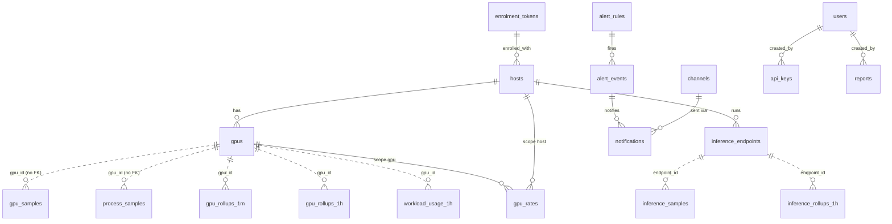

# Data Model

Every table is created by one Alembic revision,
[`0001_initial_schema.py`](../../apps/api/src/gpuwatch/migrations/versions/0001_initial_schema.py),
generated from the SQLAlchemy models in each domain's `models.py`. New changes are new
revisions; an applied revision is never edited.

- [Conventions](#conventions)
- [Overview](#overview)
- [Fleet](#fleet)
- [Telemetry](#telemetry)
- [Costs](#costs)
- [Insights and settings](#insights-and-settings)
- [Alerts](#alerts)
- [Inference](#inference)
- [Platform](#platform)
- [Retention summary](#retention-summary)

## Conventions

- **Ids:** UUID primary keys for configuration and inventory; `BIGINT` identities for
  append-heavy logs (`audit_log`, `alert_events`, `notifications`, `rollup_dirty`); natural
  composite keys for time series (`(gpu_id, ts)`, `(gpu_id, bucket)`).
- **Time:** every timestamp is `timestamptz`, stored and compared in UTC.
- **Money:** integer nano-dollars in `BIGINT` columns named `*_nusd` (1 USD = 10^9 nUSD,
  [ADR-0002](adr/0002-integer-nano-dollars.md)). The API returns them as integers too.
- **Not reported is NULL:** every metric column is nullable. NULL means the driver or
  server did not report the value, which the API returns as `null` and the dashboard shows
  as "Not available". It is never stored as 0.
- **No foreign keys on the raw time series.** `gpu_samples`, `process_samples` and the
  rollups reference GPUs and hosts by id without a constraint: they are high-volume,
  partitioned or bulk-written tables whose rows are only ever written by ingest after the
  GPU row was upserted in the same transaction, and dropped by retention.
- **JSONB** for small open-ended structures: labels, problems, evidence, histogram
  buckets, channel ids, settings.

## Overview

## Fleet

### `enrolment_tokens`

Secrets an agent exchanges once for its own host token.

| Column | Notes |
| ------ | ----- |
| `id` | UUID PK |
| `name` | Display name |
| `prefix` | 12 hex characters, `UNIQUE`; the lookup key of `gwe_<prefix>_<secret>` |
| `secret_hash` | Peppered HMAC-SHA256 of the secret part (never the plaintext) |
| `labels` | JSONB, merged into every host enrolled with it |
| `simulated` | Hosts enrolled with it are simulated (may backfill history; badged in the UI). Only `gpuwatch seed-demo` creates such tokens |
| `expires_at`, `max_uses`, `uses`, `revoked_at` | Usability: not revoked, not expired, `uses < max_uses` |
| `created_by` | FK `users.id` |

### `hosts`

One row per machine running the agent.

| Column | Notes |
| ------ | ----- |
| `id` | UUID PK |
| `machine_id` | `UNIQUE`; from `/etc/machine-id` or `GPUWATCH_MACHINE_ID`. Re-enrolling the same machine keeps the row and its history |
| `hostname`, `display_name`, `labels` | `display_name` and `labels` are editable in the dashboard |
| `token_prefix` (`UNIQUE`), `token_hash` | The current host token (`gwh_`), peppered HMAC. Rotated on every enrolment |
| `enrolled_with` | FK `enrolment_tokens.id`, `ON DELETE SET NULL` |
| `simulated` | Copied from the enrolment token |
| `agent_version`, `collector`, `os`, `kernel`, `driver_version`, `cuda_version`, `interval_s` | Updated from every batch |
| `agent_status`, `problems` | `ok` or `degraded`, with the agent's reasons (JSONB list of `{code, message}`) |
| `first_seen_at`, `last_seen_at` | Index on `last_seen_at`. Status (`pending`, `online`, `disconnected`, `revoked`) is derived from these and `revoked_at`, never stored |
| `revoked_at` | A revoked host's token is refused; history stays |

### `gpus`

| Column | Notes |
| ------ | ----- |
| `id` | UUID PK (the id used everywhere else, including the live key `gw:live:gpu:<id>`) |
| `host_id` | FK `hosts.id`, `ON DELETE CASCADE` |
| `uuid` | The NVIDIA UUID, `UNIQUE`: a card that moves to another host follows its UUID |
| `index`, `name`, `memory_total_mib`, `power_limit_w`, `pci_bus_id`, `mig_mode` | Inventory from the latest batch |
| `first_seen_at`, `last_seen_at` | `last_seen_at` drives the `lost` status |
| `retired_at` | Set by an admin for a card taken out of service; cleared when it reports again |

Index: `ix_gpus_host (host_id, index)`.

## Telemetry

### `gpu_samples` (partitioned by day)

One reading of one GPU. `PARTITION BY RANGE (ts)`, one partition per UTC day named
`gpu_samples_pYYYYMMDD`.

| Column | Notes |
| ------ | ----- |
| `gpu_id`, `ts` | Composite PK. A replayed row with the same key is ignored (`ON CONFLICT DO NOTHING`) |
| `host_id` | Index `ix_gpu_samples_host_ts (host_id, ts)` for per-host rollups and attribution |
| `interval_s` | Seconds this reading stands for (time since the agent's previous reading, capped at three intervals) |
| `util_gpu`, `util_mem` | Percent |
| `mem_used_mib`, `mem_total_mib` | MiB |
| `temp_c`, `power_w`, `power_limit_w`, `fan_pct` | |
| `sm_clock_mhz`, `mem_clock_mhz`, `pstate` | |
| `throttle_reasons` | NVML clocks event reason bit mask (`BIGINT`) |
| `pcie_rx_kbps`, `pcie_tx_kbps` | |
| `ecc_uncorrected` | Volatile uncorrected ECC count (`BIGINT`) |
| `xid` | Latest XID error code reported in this interval |
| `procs` | Processes on the GPU at sample time; NULL when the driver does not list them |

### `process_samples` (partitioned by day)

Processes on a GPU at sample time. Same partitioning as `gpu_samples`.

| Column | Notes |
| ------ | ----- |
| `gpu_id`, `ts`, `pid` | Composite PK. `ts` equals the GPU sample's `ts`, which is how attribution joins them |
| `host_id` | Index `ix_process_samples_host_ts (host_id, ts)` |
| `name`, `username`, `container_id` | From `/proc` (`comm`, `status` Uid, a 64-hex id in `cgroup`, kept as 12 characters) |
| `mem_used_mib` | Per-process memory, when the driver reports it |
| `sm_util` | Share of SM time (`nvmlDeviceGetProcessUtilization`), when the driver reports it |

### `gpu_rollups_1m` and `gpu_rollups_1h`

Minute and hour buckets per GPU, rebuilt idempotently from their source rows.

| Column | Notes |
| ------ | ----- |
| `gpu_id`, `bucket` | Composite PK |
| `host_id` | Index `(host_id, bucket)` |
| `samples`, `seconds` | Count and summed `interval_s` |
| `util_avg`, `util_max`, `util_mem_avg` | Averages over reported values only (hours are seconds-weighted over the minutes that reported the metric) |
| `mem_used_avg`, `mem_used_max`, `mem_total` | |
| `temp_avg`, `temp_max`, `power_avg`, `power_max`, `energy_wh` | `energy_wh = sum(power_w * interval_s) / 3600` |
| `fan_avg`, `sm_clock_avg` | |
| `busy_s` | Seconds with utilization at or above 50% (NULL when no utilization was reported) |
| `throttle_power_s`, `throttle_thermal_s`, `throttle_hw_s` | Busy seconds slowed by each throttle group (NULL when no throttle reasons were reported) |
| `procs_max`, `ecc_max`, `xid_count` | `xid_count` counts samples with an XID |

### `ingest_batches`

Batch ids already accepted. PK `(host_id, batch_id)`; index on `received_at`. A replayed
batch hits the PK and is answered `duplicate: true` without writing anything.

### `rollup_dirty`

Ranges of one host whose rollups must be recomputed because rows arrived late.
`id BIGINT` PK, `host_id`, `from_ts`, `to_ts`. Rows are deleted only after the recompute
succeeded.

### `job_state`

One row per worker job that needs a watermark. PK `name`; `watermark`, `ran_at`. The
`rollup` row holds the last closed minute.

## Costs

### `gpu_rates`

Hourly rates. GPUWatch ships none.

| Column | Notes |
| ------ | ----- |
| `id` | UUID PK |
| `scope` | `model`, `host` or `gpu` |
| `gpu_model` | Exact GPU name as the driver reports it (scope `model`) |
| `host_id`, `gpu_id` | FKs with `ON DELETE CASCADE` (scopes `host`, `gpu`) |
| `nusd_per_hour` | `BIGINT` nano-dollars |
| `note`, `updated_at`, `created_at` | |

Constraints: `ck_gpu_rates_scope` (exactly the target column of the scope is set) and one
partial unique index per scope (`uq_gpu_rates_model`, `uq_gpu_rates_host`,
`uq_gpu_rates_gpu`), so a target has at most one rate.

### `workload_rules`

Map processes to a workload and a team, first match by `priority` wins.

| Column | Notes |
| ------ | ----- |
| `id` | UUID PK |
| `priority` | Lower first |
| `workload`, `team` | |
| `process_pattern` | Regular expression searched in the process name (validated on write) |
| `container_prefix`, `username`, `host_label` (`key=value`) | Every set condition must match |
| `enabled` | |

### `workload_usage_1h`

Seconds per (GPU, hour, workload), the input of every cost figure.

| Column | Notes |
| ------ | ----- |
| `gpu_id`, `bucket`, `workload` | Composite PK. `workload = ''` is the idle bucket (nothing running); `(unattributed)` is busy time on a GPU whose driver lists no processes |
| `host_id`, `team` | |
| `seconds` | Per (GPU, hour) these add up to the summed `interval_s` of that hour's samples |
| `idle_seconds` | Part of `seconds` spent below the idle threshold (for a workload: held but not working) |

Index: `ix_workload_usage_bucket (bucket)`.

### `reports`

Cost report exports. The CSV lives in object storage; the row keeps only the key.

| Column | Notes |
| ------ | ----- |
| `id` | UUID PK |
| `group_by`, `params` | Grouping and the aligned window |
| `object_key` | `reports/<id>.csv` |
| `filename`, `rows`, `bytes`, `total_nusd`, `note`, `created_by` | |

Index on `created_at`.

## Insights and settings

### `insights`

| Column | Notes |
| ------ | ----- |
| `id` | UUID PK |
| `kind` | `idle_loaded`, `idle_empty`, `underused`, `oversized_vram`, `throttled`, `memory_pressure`, `gpu_errors`, `inference_queueing`, `inference_overprovisioned` |
| `fingerprint` | `<kind>:<subject id>` |
| `host_id`, `gpu_id`, `endpoint_id` | FKs, `ON DELETE CASCADE` |
| `severity`, `title`, `summary`, `recommendation` | |
| `evidence` | JSONB, rule specific ([insights.md](insights.md)) |
| `window_start`, `window_end` | |
| `est_monthly_nusd` | Nullable estimate |
| `status` | `open`, `acknowledged`, `dismissed`, `resolved` |
| `first_seen_at`, `last_seen_at`, `resolved_at`, `acted_by` | |

Indexes: `ix_insights_status_seen (status, last_seen_at)` and the partial unique index
`uq_insights_open_fingerprint (fingerprint) WHERE status <> 'resolved'`: at most one
unresolved finding per condition.

### `app_settings`

Key-value JSONB documents (`key` PK, `value`, `updated_at`, `updated_by`). The `insights`
key holds the idle rule and insight thresholds.

## Alerts

### `alert_rules`

| Column | Notes |
| ------ | ----- |
| `id` | UUID PK |
| `name`, `kind` | `threshold`, `agent_offline`, `gpu_lost` |
| `metric`, `operator`, `threshold` | For `threshold`: `util_gpu`, `util_mem`, `mem_used_pct`, `temp_c`, `power_w`, `power_pct`, `fan_pct`; `gt` or `lt` |
| `duration_s` | How long every sample must breach |
| `scope_host_id`, `scope_gpu_id`, `scope_label` | Optional scope (FKs cascade) |
| `severity` | `info`, `warning`, `critical` |
| `channel_ids` | JSONB list of channel ids |
| `notify_resolved`, `enabled` | |

The migration inserts four built-in rules: "Agent offline", "GPU lost", "GPU too hot"
(`temp_c > 85` for 120 s) and "GPU memory almost full" (`mem_used_pct > 95` for 300 s).

### `alert_events`

| Column | Notes |
| ------ | ----- |
| `id` | `BIGINT` PK |
| `rule_id` | FK, `ON DELETE CASCADE` |
| `target_key` | `gpu:<id>` or `host:<id>` |
| `host_id`, `gpu_id`, `severity`, `message`, `value` | |
| `started_at`, `resolved_at` | |

Indexes: `ix_alert_events_started (started_at)` and the partial unique index
`uq_alert_events_open (rule_id, target_key) WHERE resolved_at IS NULL`, which is what makes
an alert fire exactly once.

### `channels`

| Column | Notes |
| ------ | ----- |
| `id` | UUID PK |
| `name` | `UNIQUE` |
| `kind` | `email` or `webhook` |
| `emails`, `url` | |
| `sealed_secret` | Webhook signing secret sealed with KMS or AES-GCM, bound to `channel:<id>` |
| `enabled`, `last_delivery_at`, `last_error` | |

### `notifications`

The outbox.

| Column | Notes |
| ------ | ----- |
| `id` | `BIGINT` PK |
| `event_id` | FK `alert_events.id` (NULL for test notifications), cascade |
| `channel_id` | FK, cascade |
| `transition` | `fired`, `resolved` or `test` |
| `payload` | The exact JSON sent |
| `attempts`, `next_attempt_at`, `delivered_at`, `failed_at`, `last_error` | |

Index: `ix_notifications_pending (next_attempt_at) WHERE delivered_at IS NULL AND
failed_at IS NULL`.

## Inference

### `inference_endpoints`

| Column | Notes |
| ------ | ----- |
| `id` | UUID PK |
| `host_id` | FK, cascade |
| `name` | `UNIQUE (host_id, name)` as `uq_inference_endpoint_name` |
| `kind`, `url`, `model` | `vllm` or `tgi`; the model is kept when a scrape does not carry it (TGI) |
| `gpu_ids` | JSONB list of bound GPU ids |
| `up`, `last_seen_at` | |

### `inference_samples`

Per-interval deltas from the agent. PK `(endpoint_id, ts)`. Not partitioned; trimmed by
retention at the raw cutoff.

| Column | Notes |
| ------ | ----- |
| `interval_s`, `up` | |
| `requests`, `prompt_tokens`, `generation_tokens` | Counter deltas for the interval |
| `running`, `waiting`, `kv_cache_usage` | Gauges at scrape time |
| `ttft`, `itl`, `e2e` | JSONB `{"<upper bound>": count}`, non-cumulative per interval |

### `inference_rollups_1h`

PK `(endpoint_id, bucket)`: `seconds`, `up_seconds`, summed counters, weighted gauge
averages, `waiting_max`, `kv_cache_max`, merged histograms.

## Platform

### `users`

`id` UUID PK, `email` `UNIQUE`, `name`, `password_hash` (Argon2), `role` (`owner`,
`admin`, `viewer`), `disabled`, `last_login_at`, `failed_logins`, `locked_until`,
`session_version` (bumped on a password change, a role or access change by an owner, and
`gpuwatch create-owner`: sessions issued before stop working).

### `revoked_sessions`

Signed-out session ids. `jti` PK, `expires_at` (index). Rows past their expiry are
pruned on each sign-out.

### `api_keys`

`id` UUID PK, `name`, `prefix` (`UNIQUE`), `secret_hash` (peppered HMAC), `rpm_limit`,
`expires_at`, `revoked_at`, `last_used_at`, `created_by` (FK `users.id`).

### `audit_log`

Append-only. `id BIGINT` PK, `at` (index), `actor_id`, `actor_email`, `action`,
`target_type`, `target_id`, `details` (JSONB), `ip`. A trigger
(`audit_log_append_only`, function `gpuwatch_refuse_change()`) raises on any `UPDATE` or
`DELETE`, so not even the application role can rewrite history.

## Retention summary

Run hourly by the worker ([`telemetry/retention.py`](../../apps/api/src/gpuwatch/telemetry/retention.py)).

| Data | Kept | Mechanism |
| ---- | ---- | --------- |
| `gpu_samples`, `process_samples` | `RAW_RETENTION_DAYS` (7) | Whole daily partitions dropped once their day is before both the raw cutoff and the rollup watermark |
| `inference_samples` | `RAW_RETENTION_DAYS` | `DELETE` by `ts` |
| `gpu_rollups_1m` | `ROLLUP_1M_RETENTION_DAYS` (30) | `DELETE` by `bucket` |
| `gpu_rollups_1h`, `workload_usage_1h`, `inference_rollups_1h` | `ROLLUP_1H_RETENTION_DAYS` (400) | `DELETE` by `bucket` |
| `ingest_batches` | 2 days | `DELETE` by `received_at` (row primary keys still deduplicate older replays) |
| `notifications` | 30 days after delivery or final failure | `DELETE` |
| `reports` and their CSV objects | `REPORT_RETENTION_DAYS` (30) | Row and object deleted; on AWS the bucket lifecycle also expires objects |
| `revoked_sessions` | Until the session would have expired | Pruned on sign-out |
| `audit_log` | Forever | Append-only trigger |
| Configuration, inventory, insights, alert events | Kept | Not trimmed in 0.1.0 |
