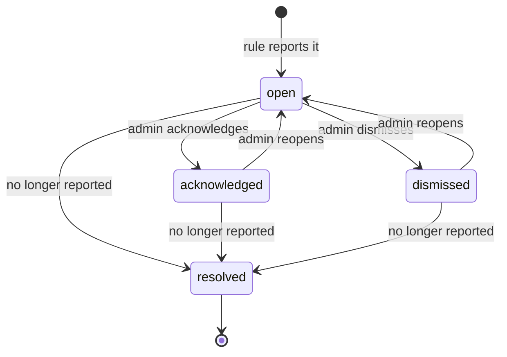

# Insights

The insights engine turns minute rollups into ranked findings with evidence: what was
observed, over which window, what it cost at your rates, and what to do. It never claims a
saving and never acts on a machine. Code:
[`insights/engine.py`](../../apps/api/src/gpuwatch/insights/engine.py) (pure rules, no I/O),
[`insights/service.py`](../../apps/api/src/gpuwatch/insights/service.py) (evaluation,
storage, lifecycle, "explain this GPU"),
[`insights/settings.py`](../../apps/api/src/gpuwatch/insights/settings.py) (thresholds).

- [How evaluation runs](#how-evaluation-runs)
- [Thresholds](#thresholds)
- [Definitions shared by the rules](#definitions-shared-by-the-rules)
- [The rules](#the-rules)
- [Monthly estimates](#monthly-estimates)
- [Lifecycle](#lifecycle)
- [Explain this GPU](#explain-this-gpu)
- [Tests](#tests)

## How evaluation runs

The worker's `insights` job runs every `INSIGHT_EVAL_INTERVAL_S` (60 s), and an admin can
trigger it with `POST /api/v1/insights/evaluate` ("Check now"). One evaluator runs at a
time (`pg_try_advisory_xact_lock('gpuwatch:insights')`).

1. Load the thresholds from `app_settings` (key `insights`; missing keys use defaults).
2. Window: the last `window_days` (7) for GPU rules.
3. For every GPU that is not retired, on a host that is not revoked: its minute rollups in
   the window (one query for the fleet), the workloads that held it while idle
   (`workload_usage_1h.idle_seconds`, most first), and its applied rate.
4. A catalog of cheaper cards: every GPU model in the fleet that has a model-level rate,
   with the largest memory seen for that model.
5. Run the GPU rules. Health rules (throttled, memory pressure, errors) look only at the
   last 24 hours of the window.
6. For every inference endpoint: per-minute requests, waiting, KV cache and tokens over the
   last day, and its bound GPUs' cost and average utilization.
7. Store the findings ([Lifecycle](#lifecycle)).

## Thresholds

Editable by admins in Settings, Insight rules (`PUT /api/v1/settings/insights`). Defaults:

| Setting | Default | Range | Used by |
| ------- | ------- | ----- | ------- |
| `idle_util_pct` | 5.0 | 0 to 50 | A minute is idle below this average utilization. Also the attribution idle threshold |
| `idle_min_minutes` | 30 | 5 to 1440 | A run of idle minutes counts once it lasts this long |
| `idle_min_share` | 0.1 | 0 to 1 | Idle findings need idle runs to add up to this share of monitored time |
| `held_mem_pct` | 10.0 | 1 to 90 | A GPU is held (a model loaded) when it has processes or at least this share of VRAM in use |
| `window_days` | 7 | 1 to 30 | Window of the spend findings and of "explain this GPU" |
| `underused_util_pct` | 30.0 | 5 to 90 | Underused below this average while working |
| `underused_min_hours` | 6.0 | 1 to 168 | Underused needs at least this much working time |
| `oversized_peak_pct` | 40.0 | 5 to 90 | Oversized when peak VRAM stays below this share of the card |
| `throttle_pct` | 10.0 | 1 to 100 | Throttled when a reason slows at least this share of busy time |
| `mem_pressure_pct` | 95.0 | 50 to 100 | Memory pressure at or above this share of VRAM |
| `mem_pressure_minutes` | 10 | 1 to 1440 | for at least this many minutes in the last day |
| `kv_cache_full` | 0.9 | 0.5 to 1 | Inference queueing when the KV cache is at or above this |
| `queue_minutes` | 15 | 1 to 1440 | with requests waiting, for at least this many minutes |
| `overprovisioned_util_pct` | 20.0 | 1 to 90 | Inference overprovisioned when the bound GPUs average below this |

Fixed values in the code: busy means utilization at or above 50% (throttle accounting in
the rollups); throttled needs at least 30 minutes of busy time with reported reasons;
oversized needs at least a day of data and a candidate with at least 1.25 times the peak.

## Definitions shared by the rules

- **Minute:** one row of `gpu_rollups_1m` (average and maximum utilization, maximum VRAM,
  maximum process count, busy and throttle seconds, ECC and XID counts, monitored seconds).
- **Idle minute:** `util_avg` is known and below `idle_util_pct`. Unknown utilization is
  never idle.
- **Held minute:** at least one process, or `mem_used_max / mem_total` at or above
  `held_mem_pct`.
- **Idle run:** consecutive minutes (no gap in the data) matching a predicate, lasting at
  least `idle_min_minutes`. A missing minute ends a run.
- **Monitored time:** the sum of the minutes' seconds in the window.

## The rules

Each finding has a `kind`, a subject (the GPU or endpoint id), a severity, a title, a
summary, a recommendation, a window, evidence and, where it makes sense, an estimated
monthly cost.

### `idle_loaded`: model loaded but idle

Idle runs of minutes that are both idle and held, adding up to at least `idle_min_share`
of monitored time.

- **Severity:** warning when the idle share is 25% or more, else info.
- **Cost:** `round(idle_seconds * rate / 3600)` at the GPU's applied rate (acceptance
  criterion 4: rate times idle hours, exactly).
- **Evidence:** `idle_seconds`, `idle_hours`, `monitored_hours`, `share`, `runs`,
  `longest {start, end}`, `periods` (the 10 longest runs with hours), `idle_util_pct`,
  `min_minutes`, `nusd_per_hour`, `cost_nusd`, `holders` (up to 5 workloads that held it
  while idle).
- **Recommendation:** unload the model or scale to zero after a quiet period, or
  consolidate onto a busy GPU.

### `idle_empty`: nothing running

The same as `idle_loaded` for minutes that are idle and not held (no process, little
VRAM). Same severity rule, cost and evidence (without `holders`). Recommendation: release
or stop the machine, or schedule work onto it.

### `underused`: low utilization while working

Minutes with processes and utilization at or above `idle_util_pct` count as working. When
working time is at least `underused_min_hours` and its seconds-weighted average
utilization is below `underused_util_pct`.

- **Severity:** info. **Evidence:** `busy_hours`, `avg_util`, `threshold_pct`. No cost
  estimate.
- **Recommendation:** larger batches or more concurrency, check input pipeline stalls,
  share the GPU (MIG, MPS, replicas).

### `oversized_vram`: peak memory far below capacity

Needs at least a day of monitored data and some minutes with processes. When peak VRAM
over the window is below `oversized_peak_pct` of the card.

- **Candidate card:** from the catalog, the cheapest model (by your model rate) that is not
  this model, has at least 1.25 times the peak memory, and costs less per hour than this
  GPU's applied rate. **GeForce cards are never suggested for a non-GeForce GPU** (consumer
  cards are not licensed for data centre use); a GeForce GPU may be offered another
  GeForce.
- **Severity:** info. **Cost estimate:** `(rate - candidate rate) * 730` hours when there
  is a candidate, else none.
- **Evidence:** `peak_mib`, `total_mib`, `peak_pct`, `monitored_hours`, `candidate {model,
  memory_total_mib, nusd_per_hour}` when there is one.

### `throttled`: slowed by power, thermal or hardware

Over the last 24 hours, minutes that reported both busy and throttle seconds. Needs at
least 1,800 busy seconds. For each group (power, thermal, hardware) the share of busy
time it slowed; groups at or above `throttle_pct` count, the largest names the finding.

- **Severity:** critical when the main reason is thermal or hardware at 25% or more, else
  warning (acceptance criterion 8: the reason is named).
- **Evidence:** `busy_hours`, `shares {power, thermal, hw}`, `main_reason`.
- **Recommendation:** per reason (check the power limit and PSU; improve cooling; check
  cooling, power cables and the system event log).

### `memory_pressure`: out-of-memory risk

Over the last 24 hours, at least `mem_pressure_minutes` minutes with maximum VRAM at or
above `mem_pressure_pct` of the card. Severity warning. Evidence: `minutes`, `peak_mib`,
`total_mib`.

### `gpu_errors`: hardware errors

Over the last 24 hours, new uncorrected ECC errors (the maximum minus the minimum of the
volatile counter, with at least two readings) or any XID event. Severity critical.
Evidence: `ecc_new`, `xid_events`.

### `inference_queueing`: requests queued with the KV cache full

Over the last day, at least `queue_minutes` minutes with requests waiting and KV cache use
at or above `kv_cache_full`. Severity warning. Evidence: `minutes`, `kv_cache_threshold`.
TGI exposes no KV cache gauge, so this rule applies to vLLM endpoints.

### `inference_overprovisioned`: serving at low GPU utilization

Over the last day, the endpoint served requests while its bound GPUs averaged below
`overprovisioned_util_pct` utilization. Severity info. Evidence: `requests`,
`gpu_util_avg`, `tokens`, `cost_nusd`, `nusd_per_million_tokens` (null without a rate).

## Monthly estimates

Estimates are labelled as estimates and computed only from your own rates:

- **Idle findings:** the window's idle cost scaled to 30 days by monitored time,
  `round(cost * 30 * 86400 / monitored_seconds)`, and only once there is at least a day of
  monitored data. A GPU monitored for two days does not get a 30-day projection from two
  hours of data.
- **Oversized:** the hourly difference to the candidate card times 730 hours.
- **Every other rule:** no estimate (`est_monthly_nusd` is null).

The Insights page sums the open findings' estimates; the overview's "waste found, per
month" sums those of `idle_loaded`, `idle_empty` and `oversized_vram` that are open or
acknowledged.

## Lifecycle

- A finding's identity is its **fingerprint**, `<kind>:<subject id>`. The partial unique
  index `uq_insights_open_fingerprint ... WHERE status <> 'resolved'` allows one
  unresolved row per fingerprint.
- On each evaluation, a reported finding updates the unresolved row with its fingerprint
  (new evidence, window, cost, `last_seen_at`) **keeping its status**, so an acknowledged
  or dismissed finding stays that way while the condition lasts. A new fingerprint creates
  an `open` row.
- An unresolved row whose fingerprint was not reported is **resolved** (`resolved_at`
  set): the condition cleared. If the problem comes back, a new `open` row is created.
- Admins act with `POST /api/v1/insights/{id}/actions` (`acknowledge`, `dismiss`,
  `reopen`); every action is audited. A resolved finding cannot be acted on.
- Listing sorts open first, then acknowledged, then the rest; within each by estimated
  monthly cost (highest first), then severity.

## Explain this GPU

`GET /api/v1/gpus/{id}/explain` answers "why is this GPU expensive or slow?" in a few
sentences, from the same exact cost allocations as the Costs page and the GPU's open or
acknowledged findings: what it cost over `window_days` and for which workloads, how much
of that paid for idle time (held and empty), the throttle summary, and memory pressure,
errors or underuse. The headline is "Expensive because it sits idle N% of the time" when
idle and held idle reach 25% of its cost, else the throttle finding, else the top finding.
Without a rate it says to set one; with too little data it says so.

## Tests

| Behaviour | Test |
| --------- | ---- |
| Idle runs need contiguous minutes of the minimum length; a gap ends a run | `tests/unit/insights/test_engine.py::test_idle_runs_need_contiguous_minutes_of_the_minimum_length`, `test_a_gap_in_data_ends_a_run` |
| Idle with a model loaded costs rate times idle time | `test_engine.py::test_idle_with_a_model_loaded_costs_rate_times_idle_time` |
| The monthly estimate scales to 30 days | `test_engine.py::test_the_monthly_estimate_scales_to_30_days` |
| No rate: no cost, still a finding; unknown utilization is never idle | `test_engine.py::test_no_rate_means_no_cost_but_still_a_finding`, `test_unknown_utilization_is_never_idle` |
| Underused, oversized (cheaper card from your own rates), throttled (dominant reason) | `test_engine.py::test_underused_needs_enough_busy_time_at_low_utilization`, `test_oversized_suggests_a_cheaper_card_that_fits_from_your_own_rates`, `test_throttling_names_the_dominant_reason` |
| Memory pressure and hardware errors; health rules look at the last day | `test_engine.py::test_memory_pressure_and_hardware_errors`, `test_health_rules_only_look_at_the_last_day` |
| Inference queueing and overprovisioning | `test_engine.py::test_inference_queueing_and_overprovisioning` |
| Settings change what counts as idle | `tests/integration/test_telemetry.py::test_insight_settings_change_what_counts_as_idle` |
| Acknowledge, dismiss, resolve by themselves | `test_telemetry.py::test_insights_can_be_acknowledged_dismissed_and_resolve_themselves` |
| Overview and explanation | `test_telemetry.py::test_overview_and_explanation` |
| Idle spend and throttling, end to end | `tests/integration/test_acceptance.py::test_4_a_loaded_but_idle_gpu_costs_rate_times_idle_hours`, `test_8_power_capping_during_busy_time_is_named` |
