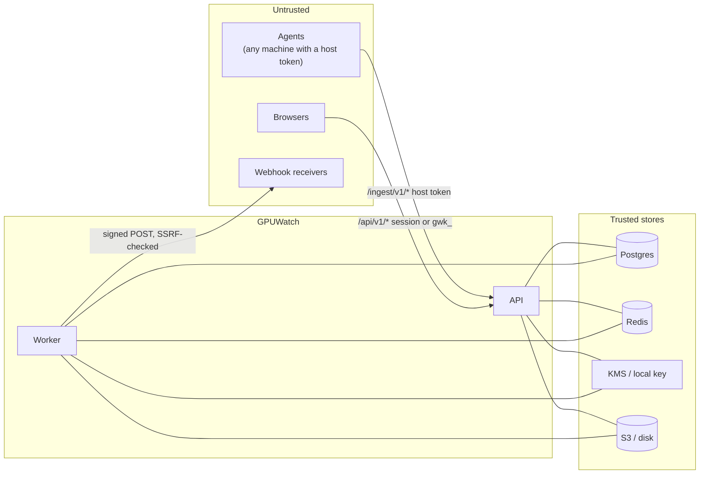

# Security

How GPUWatch protects the dashboard, the agent channel, the secrets it holds and the
machines it watches. The attacker's view is in [threat-model.md](threat-model.md).

- [What there is to protect](#what-there-is-to-protect)
- [Trust boundaries](#trust-boundaries)
- [Dashboard authentication](#dashboard-authentication)
- [Roles](#roles)
- [Read-only API keys](#read-only-api-keys)
- [The agent trust boundary](#the-agent-trust-boundary)
- [The agent is observe only](#the-agent-is-observe-only)
- [Webhooks](#webhooks)
- [Secrets at rest](#secrets-at-rest)
- [Metrics endpoint](#metrics-endpoint)
- [Audit log](#audit-log)
- [Logs, errors and headers](#logs-errors-and-headers)
- [Privacy](#privacy)
- [Production boot guards](#production-boot-guards)
- [Operator checklist](#operator-checklist)
- [Residual risks](#residual-risks)

## What there is to protect

| Asset | Why it matters |
| ----- | -------------- |
| Fleet inventory and history | Host names, GPU models, process names, users and container ids describe your infrastructure and workloads |
| Cost data and rates | Commercially sensitive |
| Host tokens (`gwh_`) and enrolment tokens (`gwe_`) | Let a caller write telemetry as a host, or enrol a new one |
| API keys (`gwk_`) | Read access to everything a viewer sees |
| Webhook signing secrets | Let a caller forge GPUWatch alerts to your receivers |
| The GPU machines themselves | GPUWatch must never become a way to run something on them |

## Trust boundaries

Agent batches and browser requests are untrusted input and are validated at the boundary.
Webhook URLs are untrusted destinations typed by an admin and checked before every request.
Security state (sessions, revocations, lockout counters, token hashes) lives in Postgres,
never only in an evictable cache.

## Dashboard authentication

[`auth/`](../../apps/api/src/gpuwatch/auth), [`core/security.py`](../../apps/api/src/gpuwatch/core/security.py)

- **Passwords** are hashed with Argon2 (argon2-cffi defaults). Verification runs off the
  event loop. An unknown email is verified against a dummy hash, so it costs the same time
  as a known one. The policy requires at least 10 characters, upper and lower case letters
  and a digit.
- **Brute force:** 20 sign-in attempts per minute per client address (sliding window in
  Redis), and a per-account lockout of 15 minutes after 5 failures. The failure counter is
  incremented atomically in SQL, so parallel wrong passwords cannot share one count
  (`test_parallel_wrong_passwords_still_lock_the_account`). The client address comes from
  uvicorn's proxy-header handling, which trusts `X-Forwarded-For` only from
  `FORWARDED_ALLOW_IPS` (the VPC CIDR on AWS), so a client cannot forge its way past the
  throttle (`test_forwarded_for_cannot_dodge_the_login_throttle`).
- **Sessions** are HS256-signed tokens (audience `gpuwatch-dashboard`, a random `jti`,
  expiry `SESSION_TTL_HOURS`, 12 by default) carrying the user id, role and
  `session_version`. The dashboard keeps it in the `gw_session` cookie (httpOnly,
  `SameSite=Lax`, `Secure` when `COOKIE_SECURE=true`); API clients may send it as a Bearer
  header. Server-side state lives in Postgres:
  - **sign-out** records the `jti` in `revoked_sessions` until the token would have
    expired, so a copied token is refused afterwards, even if every cache is flushed
    (`test_logout_ends_the_session_server_side`,
    `test_signed_out_session_survives_cache_eviction`);
  - **password change, role or access change, and `create-owner`** bump the user's
    `session_version`, which ends every older session at once
    (`test_password_change_ends_other_sessions`);
  - a disabled user is refused on the next request.
- **CSRF:** a request authenticated by the cookie that changes anything (not GET, HEAD or
  OPTIONS) must carry `X-GPUWatch-CSRF: 1`. A browser cannot add a custom header to a
  cross-site request without a CORS preflight, and the CORS allowlist (`CORS_ORIGINS`)
  refuses foreign origins, so a forged form or fetch fails without server-side token state
  (`test_cookie_session_requires_csrf_header`). An explicit `Authorization` header needs no
  CSRF check: browsers never attach it cross-site.
- **The login response** carries `Cache-Control: no-store`.

## Roles

| Role | Can |
| ---- | --- |
| `viewer` | Read every screen and endpoint except users, API keys, enrolment tokens and the audit log |
| `admin` | Everything a viewer can, plus hosts (rename, relabel, revoke), GPUs (retire), enrolment tokens, rates, workload rules and re-attribution, reports, insight actions and thresholds, alert rules and channels, API keys, listing users, the audit log |
| `owner` | Everything an admin can, plus creating users and changing a user's role or access. At least one active owner always remains (the check locks the owner rows, so two owners demoting each other at once cannot both pass: `test_two_owners_demoting_each_other_keep_an_owner`) |

Roles are checked by one dependency per route (`Viewer`, `Admin`, `Owner`); nobody can
change their own role or disable themselves. `test_roles_are_enforced` and
`test_12_a_viewer_reads_but_cannot_change` cover the matrix.

## Read-only API keys

[`keys/`](../../apps/api/src/gpuwatch/keys)

- Format `gwk_<12 hex prefix>_<secret>`. Only `HMAC-SHA256(API_KEY_PEPPER, secret)` is
  stored; the prefix is the lookup key. A leaked database alone cannot be turned into
  usable keys. The full key is shown once.
- A key acts as a `viewer` and only on safe methods: any other method is refused with
  `read_only_key` before the route runs (`test_api_keys_read_but_never_write`). The audit
  log, users and keys stay admin-only, so a key cannot read them either.
- Each key has a rate limit (its own or `DEFAULT_RPM_LIMIT`, 600 a minute), an optional
  expiry, and can be revoked; revocation takes effect on the next request (config cache
  invalidation).

## The agent trust boundary

An agent is any process that holds a host token. It is treated as untrusted input.

| Control | Where | Test |
| ------- | ----- | ---- |
| **Enrolment tokens** (`gwe_`): created by an admin, shown once, peppered hash, optional expiry and use limit, revocable. The token row is locked during enrolment so the use count is exact | `fleet/service.py::enrol` | `test_enrolment_tokens_are_shown_once_and_enforce_limits`, `test_expired_tokens_are_refused` |
| **Host tokens** (`gwh_`): one per host, peppered hash, rotated on every re-enrolment (the old one stops working at once), refused with `host_revoked` after an admin revokes the host | `ingest/dependencies.py` | `test_re_enrolling_a_machine_keeps_its_host_and_rotates_the_token`, `test_hosts_can_be_renamed_relabelled_and_revoked`, `test_missing_or_malformed_host_tokens_are_refused` |
| **Token kinds do not cross**: a host token is not an API key and the reverse; an agent token gets 401 on every `/api/v1` route | `core/security.py::parse_api_key` | `test_token_kinds_do_not_cross`, `test_11_agents_can_only_reach_ingest_and_get_no_commands` |
| **Per-host rate limit**: `INGEST_RPM_PER_HOST` (240 batches a minute by default), keyed by host id, 429 with `Retry-After` | `ingest/dependencies.py` | `test_ingest_is_rate_limited_per_host` |
| **Body size limit**: `MAX_BODY_BYTES` (8 MB) checked against `Content-Length` and counted for chunked bodies as they arrive, refused with 413 before any route parses them | `core/middleware.py::BodySizeLimitMiddleware` | `test_chunked_bodies_obey_the_body_limit` |
| **Row limit**: at most `INGEST_MAX_SAMPLES` (20,000) samples, processes and inference rows per batch; a larger batch is refused whole | `ingest/service.py::store` | `test_a_batch_over_the_row_limit_is_refused_whole` |
| **Invalid JSON**: bodies that are not valid UTF-8 JSON, including a lone UTF-16 surrogate (`"\ud800"`, which Python's parser accepts but Postgres cannot store), get 422 `invalid_json` instead of a 500 | `core/middleware.py` | `test_lone_surrogate_is_a_422_not_a_500` |
| **Strict schemas**: every string length, list length, label key pattern and metric range is bounded (percentages 0 to 100, temperature -50 to 200, counters below 2^62) | `ingest/schemas.py` | `test_hostile_metric_values_are_rejected_at_the_boundary` |
| **Time window**: rows newer than `now + INGEST_MAX_FUTURE_S` (120 s) or older than `RAW_RETENTION_DAYS` are dropped and counted in `dropped` | `ingest/service.py::_window` | `test_samples_outside_the_time_window_are_dropped` |
| **Simulated backfill only**: only hosts enrolled with a simulated token may send rows up to `SIMULATED_BACKFILL_DAYS` old. Simulated tokens are created only by `gpuwatch seed-demo`, a CLI command that needs shell access to the API container and refuses `ENVIRONMENT=production`; the API has no route that creates one | `ingest/service.py::_window`, `demo/seed.py` | `test_simulated_hosts_may_backfill_history` |
| **Unknown GPU drop**: samples and processes for a GPU UUID the batch did not declare in its inventory are dropped, so a host cannot write into rows it did not report | `ingest/service.py::store` | `test_an_agent_cannot_write_into_another_hosts_gpu` |
| **Idempotency**: a replayed `batch_id` writes nothing; row primary keys ignore duplicates | `ingest/service.py::store` | `test_7_resending_a_batch_is_a_no_op` |

What a host token can still do is write plausible but false telemetry about the GPUs it
declares, and move a GPU UUID to its own host by declaring it (a card that really moved
follows its UUID by design). See [residual risks](#residual-risks).

## The agent is observe only

- The agent opens **no inbound port**. Its only network calls are `POST
  /ingest/v1/enroll`, `POST /ingest/v1/batches`, and GETs of the DCGM exporter and
  inference `/metrics` URLs configured on the machine.
- The server's reply carries counts and `next_in_s`, nothing else. The agent never runs
  anything it receives. No API route starts, stops or signals a process
  (`test_11_agents_can_only_reach_ingest_and_get_no_commands` checks the route table;
  `test_observe_only_the_agent_never_runs_or_kills_anything` checks the agent's source for
  process control calls).
- The agent image runs as UID 10001 with no root. NVML needs none. Reading other users'
  process names with `--pid=host` needs `CAP_SYS_PTRACE` or `--user 0`, which is an
  operator's choice ([guides/agent.md](../guides/agent.md)).
- The host token is written to `<state dir>/host-token` with mode 0600.

## Webhooks

[`alerts/urls.py`](../../apps/api/src/gpuwatch/alerts/urls.py), [`alerts/notifier.py`](../../apps/api/src/gpuwatch/alerts/notifier.py)

- **SSRF checks** run when a channel is saved and again before every delivery (DNS may
  have changed). The host is resolved and every address is checked. Always refused:
  link-local addresses (169.254.0.0/16 and fe80::/10, which include the AWS, GCP and Azure
  metadata endpoints), the AWS IPv6 metadata address `fd00:ec2::254`, unspecified,
  multicast and reserved addresses, and schemes other than `http` and `https`. Loopback,
  private ranges and 100.64.0.0/10 are allowed by default because an internal chat relay
  is a common target; `WEBHOOK_ALLOW_PRIVATE=false` refuses them too (the AWS environments
  default to `false`). A refusal is `webhook_url_blocked` with the resolved address.
- **Redirects are never followed** by the delivery client, so a vetted URL cannot bounce
  the request to a refused address.
- **Signing:** each request carries `X-GPUWatch-Timestamp` (Unix seconds) and, when the
  channel has a secret, `X-GPUWatch-Signature: sha256=<hex>`, the HMAC-SHA256 of
  `<timestamp>.<raw body>` with the channel's secret. Receivers recompute it, compare in
  constant time and reject old timestamps to stop replays
  ([examples/webhook_receiver.py](../../examples/webhook_receiver.py)).
- Timeouts: `WEBHOOK_TIMEOUT_S` (10 s) per request, 5 s to connect.

## Secrets at rest

| Secret | Stored as |
| ------ | --------- |
| Passwords | Argon2 hash |
| API keys, host tokens, enrolment tokens | `HMAC-SHA256(API_KEY_PEPPER, secret)`; the pepper is never in the database |
| Webhook signing secrets | Sealed before they reach the database: `KEY_MODE=kms` calls KMS `Encrypt` with the encryption context `{"gpuwatch:record": "channel:<channel id>"}`; `KEY_MODE=local` uses AES-256-GCM with a key derived from `LOCAL_MASTER_KEY` and the same string as associated data. A sealed value copied to another channel row fails to open. On AWS the IAM policy allows `kms:Decrypt` only with a `gpuwatch:record` context matching `channel:*` (or through S3) |
| Session signing key, pepper, metrics token, DB and cache URLs | Environment, injected by ECS from Secrets Manager on AWS |
| Report CSVs | S3 with SSE-KMS (local disk in development) |

`SESSION_SECRET` and `API_KEY_PEPPER` must differ (the API refuses to boot otherwise):
rotating dashboard sessions must not invalidate every token hash.

## Metrics endpoint

`/metrics` lists every host and GPU by name. When `METRICS_TOKEN` is set, it requires
`Authorization: Bearer <METRICS_TOKEN>` (constant-time comparison) and returns 401
otherwise (`test_metrics_token_protects_the_fleet_exposition`). The AWS environments
generate the token in Secrets Manager and can also restrict `/metrics` at the load
balancer to `metrics_allowed_cidrs`. The worker's own metrics port (9464) has no ingress
on AWS unless `worker_metrics_cidrs` lists in-VPC scrapers.

## Audit log

Every configuration change and sign-in writes an `audit_log` row in the same transaction
as the change ([`audit/service.py`](../../apps/api/src/gpuwatch/audit/service.py)), so a
change without its audit row cannot commit. A database trigger refuses `UPDATE` and
`DELETE` on the table (`test_audit_log_records_changes_and_is_append_only`). Rows record
the actor (user, API key or `agent` for enrolments), the action, the target, details and
the client address. Admins read it in the dashboard.

## Logs, errors and headers

- The SQLAlchemy engine runs with `hide_parameters=True`, so bound values (password
  hashes, token hashes) never appear in an exception message or a log line
  (`test_racing_user_creates_conflict_without_leaking_hashes`).
- JSON logs redact any field named `authorization`, `api_key`, `password`, `secret`,
  `token` or `x-api-key`.
- Errors use one envelope with a code and a plain message; unhandled errors are logged
  with the request id and returned as `internal_error` without a stack trace.
- API responses carry `X-Content-Type-Options: nosniff`, `X-Frame-Options: DENY`,
  `Referrer-Policy: no-referrer`, `Cross-Origin-Opener-Policy: same-origin` and a
  restrictive `Permissions-Policy` (`test_security_headers_on_every_response`). The
  dashboard adds a same-origin Content-Security-Policy and, in production, HSTS.

## Privacy

GPUWatch sends nothing anywhere you did not configure: no telemetry, no update checks, no
default mail delivery (`MAIL_MODE=log`), tracing off (`OTEL_ENABLED=false`).
`tests/unit/test_privacy.py` scans the API and agent sources for hardcoded outbound hosts
and checks those defaults.

## Production boot guards

`Settings.guard()` ([`core/config.py`](../../apps/api/src/gpuwatch/core/config.py)) refuses to
start with `ENVIRONMENT=production` when:

- `SESSION_SECRET` or `API_KEY_PEPPER` is a demo value, contains `not-for-production`, or
  is shorter than 32 characters;
- `SESSION_SECRET` equals `API_KEY_PEPPER`;
- `KEY_MODE=local` and `LOCAL_MASTER_KEY` is a demo value or shorter than 32 characters;
- `GPUWATCH_CLOUD=aws` and `AWS_ENDPOINT_URL` is set (an emulator in production);
- `COOKIE_SECURE` is false.

`gpuwatch seed-demo` refuses `ENVIRONMENT=production`, because it creates well-known demo
logins.

## Operator checklist

- Generate `SESSION_SECRET`, `API_KEY_PEPPER` and (for `KEY_MODE=local`)
  `LOCAL_MASTER_KEY` as random values of 32 characters or more; on AWS they come from
  Secrets Manager.
- Serve the dashboard and `/ingest` over HTTPS only and set `COOKIE_SECURE=true`.
- Set `FORWARDED_ALLOW_IPS` to your load balancer's network, never `*` outside a private
  Compose network.
- Set `METRICS_TOKEN`, and restrict `/metrics` at the edge if you can.
- Decide on `WEBHOOK_ALLOW_PRIVATE`: keep it `false` unless a receiver is inside your
  network.
- Give enrolment tokens an expiry and a use limit; revoke them after rolling out agents.
- Revoke hosts you decommission; revoke API keys you no longer use.
- Use `KEY_MODE=kms` in production so webhook secrets are sealed by a key that never leaves
  KMS.
- Keep the agent unprivileged unless you need process names of other users.

## Residual risks

- **Private webhook targets are allowed by default.** With `WEBHOOK_ALLOW_PRIVATE=true`
  (the application default, chosen for internal chat relays), an admin can point a webhook
  at an internal service. Metadata and link-local addresses are always refused. Admins are
  trusted; set the flag to `false` when they should not reach internal hosts.
- **DNS rebinding window.** The URL is resolved and checked, then httpx resolves it again
  to connect. A hostile DNS server could answer differently in between. The check runs
  before every delivery and redirects are not followed, which narrows but does not close
  the window.
- **A host token can write false telemetry** about the GPUs it declares, within the time
  window and rate limit. Revoke the host to stop it; the audit log shows who enrolled it.
- **The simulated flag widens the time window** to `SIMULATED_BACKFILL_DAYS` for hosts
  enrolled with a simulated token. Only `seed-demo` (shell access, refused in production)
  creates such tokens; an operator who runs it in a real deployment gives those hosts the
  wider window.
- **Workload rule patterns are regular expressions** written by admins and run by the
  worker in Python's `re`. A pathological pattern could slow attribution. Patterns are
  compiled on write and length-limited (200 characters), not analysed for backtracking.
- **Process names and command lines are visible** to every viewer. They can contain
  information users consider private.
- **Without Redis, limits are per process.** With several API replicas and no Redis, the
  login throttle and API key limits apply per replica, not globally; per-account lockout
  still applies globally (Postgres).
- **The config cache allows up to 5 s** between a host or key revocation on one replica and
  its enforcement on another when the version stamp is unreachable (Redis down); with
  Redis it is at most about one second.
- **Notification delivery holds row locks** while it sends, so a hung receiver delays only
  its own batch of 20 rows, up to the webhook timeout.
