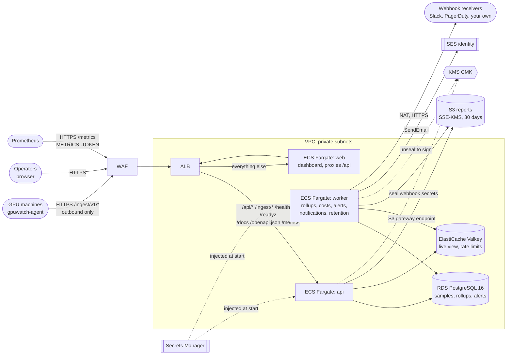

# Infrastructure

Everything needed to run Euron Open GPUWatch, from a laptop to a multi-AZ AWS
deployment, as code.

```
infra/
├── docker/        Multi-stage, non-root images: api (API, worker, CLI), web (dashboard), agent
└── terraform/
    ├── modules/   network · kms · storage · secrets · email · database · cache · ecr ·
    │              service · observability
    └── envs/
        ├── local-floci/   storage + kms + secrets + email on the Floci emulator (applied by `make up`)
        ├── aws-dev/       full stack, cost-lean (2 AZs, single NAT, single-AZ DB, one cache node)
        └── aws-prod/      full stack, resilient (3 AZs, NAT per AZ, Multi-AZ DB, cache failover)
```

## One codebase, two clouds

The modules are the same in every environment. `local-floci` points the AWS
provider at the emulator (`http://floci:4566` inside compose) and turns off
only what an HTTP-only emulator cannot do (the TLS-only bucket policy). `make up`
applies it automatically before migrate, api and worker start, and the API then
seals webhook signing secrets with KMS (`alias/gpuwatch-local`) and writes cost report
exports to S3 (`gpuwatch-local-reports`) exactly as it does on AWS. The application
switches between the two through environment variables only (`AWS_ENDPOINT_URL`,
`S3_FORCE_PATH_STYLE`); there are no emulator branches in the code.

| Resource | Local (Docker) | AWS (module) |
|---|---|---|
| PostgreSQL 16: hosts, GPUs, raw samples (partitioned by day), rollups, workload usage, insights, alerts, users, audit log | `postgres:16` container | RDS PostgreSQL (`database`) |
| Live view, rate limits, config invalidation (optional) | `redis:7` container | ElastiCache Valkey, TLS + AUTH (`cache`) |
| Cost and usage report exports (`reports/*.csv`, 30 days) | S3 on Floci | S3 (`storage`) |
| Webhook signing secret sealing, encryption at rest | KMS on Floci | KMS (`kms`) |
| Signing secrets, metrics token, connection URLs | Secrets Manager on Floci | Secrets Manager (`secrets`) |
| Alert email | Mailpit (SES identity also provisioned on Floci) | SES (`email`) |
| api, worker, web | Compose services from the same images | ECR (`ecr`) + ECS Fargate behind one ALB (`service`) |
| Logs, metrics, alarms | stdout + `/metrics` | CloudWatch (`observability`) |
| GPU agents | simulated agents in Compose | your GPU machines (outside AWS or in it) |

## AWS topology (aws-dev / aws-prod)



## How agents reach the deployment

Agents need only **outbound HTTPS** from the GPU machines; nothing connects to them.
Set `GPUWATCH_URL=https://<hostname>` (the `url` output, or the load balancer DNS name
when you have no domain yet) and enrol the host with a token from the dashboard; the
agent then posts one metric batch every `GPUWATCH_INTERVAL_S` (5 s) to
`https://<hostname>/ingest/v1/...` with its host token as `Authorization: Bearer gwh_...`.
The ALB forwards `/ingest/*` to the api; WAF counts rather than blocks the
body-inspecting rules (batches are large JSON with process command lines), and the
api's own per-host rate limit (`INGEST_RPM_PER_HOST`) and schema validation guard the
route. If the machines sit behind a firewall, allow egress to the ALB on 443 only.

## Order of operations (first deploy)

1. Request an ACM certificate for your host name in the target region.
2. `cp envs/aws-dev/terraform.tfvars.example envs/aws-dev/terraform.tfvars` and fill it in
   (optionally `backend.tf.example` to `backend.tf` for S3 state). Choose the alert
   sender with `mail_from_domain` (defaults to the host name).
3. `terraform -chdir=infra/terraform/envs/aws-dev init`
4. `terraform -chdir=infra/terraform/envs/aws-dev apply -target=module.ecr`
5. Build both images for `linux/arm64` and push them with the `image_tag` from your tfvars:
   `docker buildx build --platform linux/arm64 -f infra/docker/api.Dockerfile -t <api repo>:<tag> --push apps/api`
   (and the same for `web.Dockerfile` with `apps/web`).
6. `terraform -chdir=infra/terraform/envs/aws-dev apply`
7. Publish the `email_dns_records` output if the mail domain is not in Route53, and
   request SES production access (a sandboxed account only mails verified addresses).
8. Run the migration task with the `run_task` output (`aws ecs run-task ... --launch-type FARGATE`),
   then `create-owner` the same way with a command override
   (`["create-owner", "--email", "you@example.com"]` and `GPUWATCH_OWNER_PASSWORD` in the override environment).
9. Point DNS at `load_balancer_dns_name` if the zone is not in Route53, sign in at the
   `url` output, create an enrolment token and install the agent on your GPU machines.
10. For Prometheus, read `METRICS_TOKEN` from the `metrics_token_secret_arn` output and
    scrape `https://<hostname>/metrics` with it (optionally also limited to
    `metrics_allowed_cidrs`).

The full runbook is in [docs/guides/deploy-aws.md](../docs/guides/deploy-aws.md).
This repository itself only ever validates `aws-dev` and `aws-prod` (and applies
`aws-dev` to a throwaway Floci with `make tf-aws-on-floci`); nothing is applied to a
real account by the project's own tooling.

## Security posture at a glance

| Control | Where |
|---|---|
| No static AWS credentials anywhere (task roles and the default chain only) | all modules |
| Least-privilege IAM per app: `reports/*` objects in the reports bucket; KMS `Encrypt`/`Decrypt` only with the `gpuwatch:record = channel:*` encryption context, or via S3; SES send only for the worker and only as the alert identity; web has none | service |
| Private subnets for every runtime; no public IPs; ingress only from the ALB, none for the worker (Prometheus on 9464 only from listed in-VPC CIDRs) | network, service |
| Agents need outbound HTTPS only; host tokens are bearer credentials, redacted from WAF logs | service |
| TLS everywhere: ALB TLS 1.3/1.2 policy, `rds.force_ssl`, ElastiCache `transit_encryption_mode = required`, TLS-only bucket policy, SES `tls_policy = REQUIRE` | service, database, cache, storage, email |
| Encryption at rest with a rotating CMK (RDS, ElastiCache, S3, ECR, secrets, logs) | kms + consumers |
| Generated secrets (signing keys, metrics token, DB password, cache AUTH token) injected by ECS, never in task definitions | secrets, database, cache |
| Cache data is rebuildable (`allkeys-lru`): a full cache drops live view entries, never samples; a memory alarm warns first | cache, observability |
| WAF managed rules and a per-IP flood guard; ingest bodies only counted, not blocked | service |
| `/metrics` requires `METRICS_TOKEN`, optionally also limited to listed CIDRs at the ALB | service, secrets |
| Alarms on 5xx, p95 latency, unhealthy targets, ECS, RDS, cache, failed worker jobs and failed alert deliveries | observability |
| Read-only root filesystems, non-root containers, init process for graceful drain | docker, service |
| Static analysis: `terraform validate`, tflint, checkov (inline, reasoned skips only) | `make tf-validate tf-lint tf-security` |
